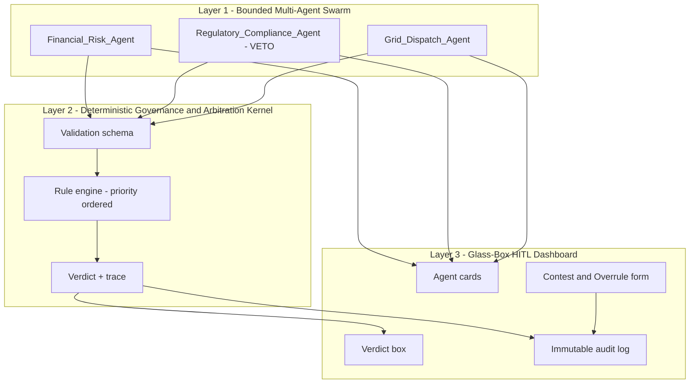

> ### Open-Source Release Notice — v1.2-DEMO (22 November 2026)
> **Independent Pre-Application Research Prototype & Architectural Demonstrator (Ref: UOL08435)**
> **Author & Copyright Holder:** EL FILALI SALAH ADDINE (© 2026)
>
> 1. **Purpose & Scope:** **AURA-Grid Research Prototype & Architectural Demonstrator** is an incomplete, non-production architectural demonstration developed independently by **EL FILALI SALAH ADDINE** solely to support his doctoral application for the position *"Doctoral Researcher in Reliable and Explainable Multi-Agent AI Systems"* (Ref: **UOL08435**) within the **UBIX Research Group / SnT** at the **University of Luxembourg**, and for subsequent academic supervision upon admission.
> 2. **100% Synthetic Data:** All grid topologies, substation identifiers, financial metrics, and failure scenarios included in this repository are entirely synthetic and simulated for conceptual demonstration. No proprietary, confidential, or real-world operational utility data is used.
> 3. **Non-Liability:** This software is an experimental academic demonstrator and must not be deployed in real operational environments. The author assumes no responsibility or liability for any use of this code outside the evaluation of his doctoral candidacy or official academic supervision.
> 4. **License Scope:** The MIT License applies **exclusively** to the code snapshot published as **Release v1.2-DEMO (22 November 2026)**. All other commits, branches, prior revisions, and subsequent versions remain proprietary (All Rights Reserved). See [`LICENSE`](LICENSE).

# AURA-Grid Research Prototype & Architectural Demonstrator — Auditable & Reliable Multi-Agent System for Regulated Energy Operations

> **Research Prototype & Architectural Demonstrator.** This is a demonstration
> artifact, not a production system. See the [Limitations & Architectural Demonstrator Warning](#10-limitations--architectural-demonstrator-warning) section.

---

## Abstract

Large Language Model (LLM) multi-agent systems are increasingly proposed for
operational decision support in critical infrastructure. In **regulated energy
operations**, however, such systems are risky: LLMs hallucinate, are
non-deterministic, and are opaque. A decision that cannot be explained or
audited is unacceptable when it may affect grid safety or regulatory
compliance.

**AURA-Grid Research Prototype & Architectural Demonstrator** demonstrates that a multi-agent LLM system can be made
**auditable** and **reliable** by enforcing a strict separation of concerns
across three layers:

1. **Bounded Multi-Agent Swarm** — agents *propose* structured opinions.
2. **Deterministic Arbitration Kernel** — a pure-Python rule engine *decides*.
3. **Glass-Box Human-in-the-Loop Dashboard** — a human *supervises* and can
   overrule, with every decision logged immutably.

The result is a reproducible offline demo (no API key required) plus an
optional live mode powered by DeepSeek.

---

## 1. Motivation & Problem Statement

Multi-agent LLM architectures are attractive for complex operational domains
because they can decompose a problem into specialized perspectives. But in a
regulated environment they introduce serious risks:

- **Hallucination** — an agent may assert a false safety limit or cost figure.
- **Non-determinism** — the same input may yield different outputs across runs.
- **Opacity** — a natural-language answer is hard to audit or reproduce.
- **Single point of failure** — one misbehaving agent can corrupt the outcome.

The core design objective is therefore to **separate *opinion generation*
(LLM) from *decision-making* (deterministic kernel + human)**. The LLM is a
generator of opinions, **never a decider**.

---

## 2. Three-Layer Architecture



### Layer 1 — Bounded Multi-Agent Swarm

Three domain-bounded agents produce structured JSON opinions:

| Agent | Bounded domain | Special authority |
|---|---|---|
| `Grid_Dispatch_Agent` | Grid topology, power flow, thermal margins, dispatch actions. | None (technical opinion). |
| `Regulatory_Compliance_Agent` | Regulatory compliance, safety limits, grid-code norms. | **VETO** — a `REJECT` overrides everything. |
| `Financial_Risk_Agent` | Costs, SLA penalties, financial exposure, ROI. | None (economic opinion). |

Each agent returns exactly:

```json
{
  "status": "APPROVE",
  "confidence": 0.0,
  "proposal": "string",
  "reasoning": "string"
}
```

Agents never apply actions; they only emit `APPROVE`, `REJECT`, or `TIMEOUT`.
An agent can fail (timeout/crash) without bringing down the system.

### Layer 2 — Deterministic Governance & Arbitration Kernel

A pure-Python rule engine (no LLM, no network, no randomness) aggregates the
opinions into a single, traceable verdict. It is the **only** component allowed
to decide. Rules are evaluated strictly top-to-bottom:

| Priority | Rule | Condition | Verdict |
|---|---|---|---|
| R1 | Regulatory Veto | `Regulatory.status == REJECT` | `REGULATORY_VETO` |
| R2 | Total Failure | all 3 agents `TIMEOUT` | `SYSTEM_FAILURE_ESCALATION` |
| R3 | Graceful Degradation | ≥1 `TIMEOUT` (not all) | `DEGRADED_CONSENSUS` / `DEGRADED_CONFLICT` |
| R4 | Inter-Agent Conflict | active agents disagree | `INTER_AGENT_CONFLICT` |
| R5 | Unanimous Reject | all 3 `REJECT` | `UNANIMOUS_REJECT` |
| R6 | Consensus Approved | all 3 `APPROVE` | `CONSENSUS_APPROVED` |

Malformed agent output is coerced into a `TIMEOUT` opinion, so the system never
crashes on a bad agent response.

### Layer 3 — Glass-Box Human-in-the-Loop Dashboard

A Streamlit UI that exposes the full reasoning (status, confidence, proposal,
reasoning per agent, plus the verdict and its rule trace), lets an operator
**contest or overrule** the decision with a mandatory justification, and appends
every decision to an **immutable, append-only audit log** stored in
`st.session_state`.

### Why this separation matters

Reliability does not come from the model — it comes from the **deterministic
kernel** and **human supervision**. The LLM can be swapped, upgraded, or fail
entirely without compromising the auditability or safety of the decision path.

---

## 3. Key Design Decisions

- **Regulatory VETO has absolute priority.** A `REJECT` from the Regulatory
  agent yields `REGULATORY_VETO` regardless of other opinions — even if another
  agent timed out. Only a human can overrule it (and that action is logged).
- **The kernel is pure Python, deterministic, and LLM-free.** Same inputs ⇒
  same verdict, always. It is total (covers all status combinations) and
  idempotent.
- **Graceful degradation.** A failing agent is isolated; the verdict is computed
  on the active agents and flagged explicitly.
- **Append-only audit log.** Entries are never modified or deleted; `entry_id`
  is incremental and monotonic.
- **Glass-box.** Every agent's reasoning and the kernel's rule trace are exposed
  in the UI.

---

## 4. Installation & Launch

```bash
pip install -r requirements.txt
streamlit run app.py
```

The app starts in **Instant Offline Simulation** mode by default and requires
**no API key**.

---

## 5. Execution Modes

### Mode A — Instant Offline Simulation (default)

- Opinions come from pre-computed scenario constants.
- No network calls, no API key.
- Fully reproducible — ideal for demos and tests.
- The crash checkbox (Scenario 3) swaps the Financial payload for a `TIMEOUT`.

### Mode B — Live DeepSeek LLM

- Uses the `openai` SDK against a DeepSeek endpoint:
  - `base_url = "https://api.deepseek.com"`
  - `model = "deepseek-chat"`
- The API key is entered in the sidebar and **never persisted to disk**.
- Each agent receives a **bounded system prompt** (role + scope + strict JSON
  format) and a user prompt with the scenario context.
- Responses are parsed robustly (markdown fences stripped, first JSON object
  extracted). Any failure — missing key, network error, unparseable output —
  degrades that agent to `TIMEOUT`, and the kernel applies graceful degradation.

---

## 6. Demonstration Scenarios

| # | Scenario | Expected verdict |
|---|---|---|
| 1 | **Consensus Load Rebalancing** — 3 `APPROVE` | `CONSENSUS_APPROVED` |
| 2 | **Regulatory Veto Conflict (Kirchberg Peak)** — Grid & Financial approve a 115% overrating; Regulatory issues a hard `REJECT` | `REGULATORY_VETO` |
| 3 | **Graceful Degradation (Node Failure)** — Financial agent crashes (checkbox) | `DEGRADED_CONSENSUS` (or `CONSENSUS_APPROVED` if the checkbox is off) |

---

## 7. Verdict Matrix

| Verdict | Severity | Recommended action | Human escalation |
|---|---|---|---|
| `CONSENSUS_APPROVED` | INFO | Execute the proposal | No |
| `UNANIMOUS_REJECT` | WARNING | Do not execute; review the plan | Yes (recommended) |
| `REGULATORY_VETO` | CRITICAL | Block the action; alternative required | Yes |
| `INTER_AGENT_CONFLICT` | WARNING | Mandatory human arbitration | Yes |
| `DEGRADED_CONSENSUS` | WARNING | Execute with enhanced monitoring | Yes (recommended) |
| `DEGRADED_CONFLICT` | CRITICAL | Mandatory human arbitration | Yes |
| `SYSTEM_FAILURE_ESCALATION` | CRITICAL | Switch to manual operation | Yes |

---

## 8. Auditability & Human-in-the-Loop

- The **Contest & Overrule** form lets an operator either *Accept AI Verdict* or
  *Overrule & Force Manual Action*.
- A **justification is mandatory** when overruling; otherwise the submission is
  rejected with an error and nothing is written.
- Every arbitration automatically logs an **AI verdict** entry; every form
  submission logs a **human decision** entry.
- The audit log is displayed as a table (most recent first) and as raw JSON. It
  is **append-only** and stored in `st.session_state`.

Example audit entry:

```json
{
  "entry_id": 1,
  "timestamp_utc": "2026-11-16T00:00:00Z",
  "scenario": "SCENARIO_REGULATORY_VETO",
  "mode": "offline",
  "ai_verdict": "REGULATORY_VETO",
  "human_decision": "Overrule & Force Manual Action",
  "justification": "Operator confirmed alternative remedial action within 100% rating.",
  "agent_statuses": {
    "Grid_Dispatch_Agent": "APPROVE",
    "Regulatory_Compliance_Agent": "REJECT",
    "Financial_Risk_Agent": "APPROVE"
  }
}
```

---

## 9. Project Structure

The entire application lives in a single file to keep the Research Prototype & Architectural Demonstrator self-contained:

```
aura-grid-poc/
├── app.py            # Full application (3 layers, single file)
├── requirements.txt  # streamlit, openai
├── README.md         # This document
└── SPEC.md           # Technical specification
```

---

## 10. Limitations & Architectural Demonstrator Warning

> ⚠️ **This is a Research Prototype & Architectural Demonstrator for
> demonstration purposes only — NOT a production system.**
>
> - All data is **simulated**; regulatory thresholds are **illustrative**.
> - There is **no connection** to any real SCADA/EMS or grid control system.
> - The audit log is **in-memory** (`st.session_state`) and is lost on session
>   reset.
> - **Do not use this software for real operational decisions.**

---

## 11. Future Work

- Persist the audit log in a durable database.
- Add cryptographic signatures / hash-chaining to audit entries for tamper
  evidence.
- Integrate real SCADA/EMS data streams.
- Add unit tests for the deterministic kernel (property-based testing of the
  seven verdicts).
- Formalize the rule engine as a verifiable policy specification.

---

## 12. License

**Release v1.2-DEMO (22 November 2026)** is released as **open source** under
the **MIT License**. You are free to use, copy, modify, merge, publish,
distribute, sublicense, and/or sell copies of this specific release, provided
the copyright, scope-restriction, and permission notices are retained. See the
[`LICENSE`](LICENSE) file for the full text.

**Scope restriction.** This MIT grant is deliberately **limited to the
v1.2-DEMO snapshot published on 22/11/2026**. All other commits, branches,
prior revisions, private repositories, and subsequent versions
(post-v1.2-DEMO) remain the **exclusive proprietary intellectual property** of
**EL FILALI SALAH ADDINE (All Rights Reserved)** and are **not** covered by
this open-source grant.

**© 2026 EL FILALI SALAH ADDINE.** This prototype was developed for the
evaluation of the Author's doctoral application (Job Reference: **UOL08435**)
within the **UBIX Research Group / SnT** at the **University of Luxembourg**,
and for subsequent official academic supervision upon admission.

> ⚠️ **Disclaimer.** This software is an **incomplete Research Prototype &
> Architectural Demonstrator**, provided **"AS IS"**, without warranty of any
> kind, express or implied. It is **not certified** for real-world energy grid
> operations and must not be used for operational decisions.
