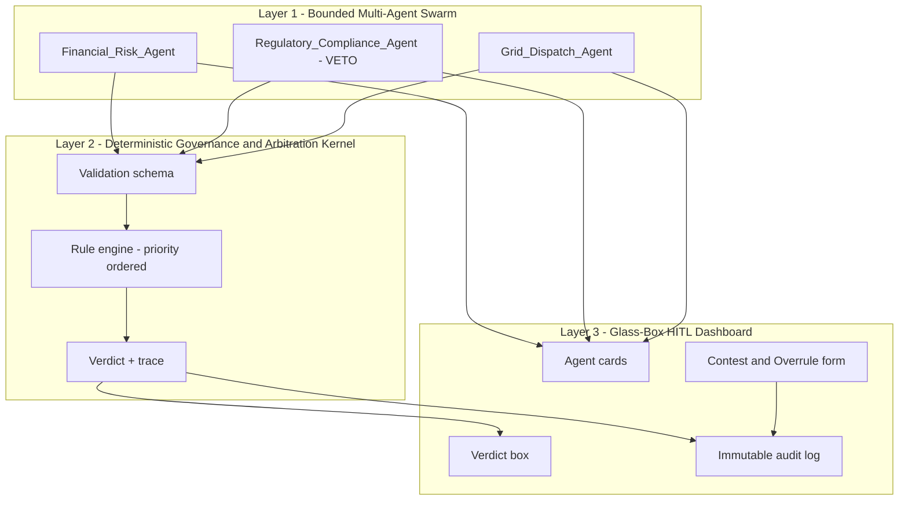
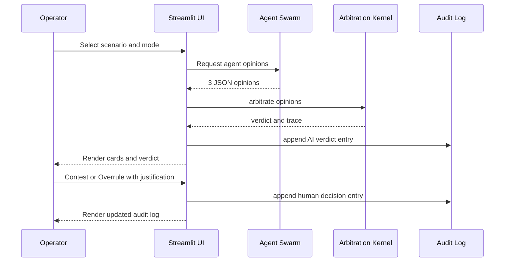
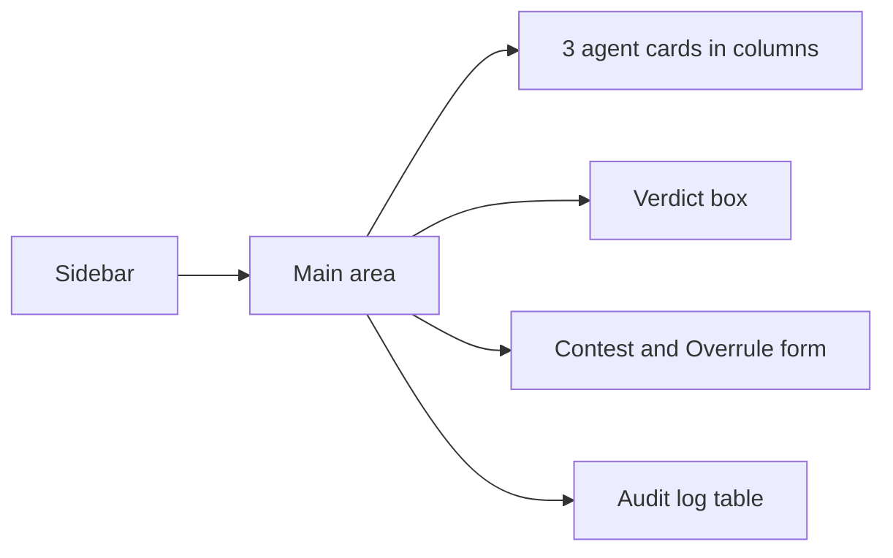

# SPEC.md — AURA-Grid PoC

**Auditable & Reliable Multi-Agent System for Regulated Energy Operations**

Version : 1.0 — Document de conception technique (PoC)
Cible d'implémentation : un unique fichier `app.py` (Streamlit / Python 3.10+)
Livrables finaux autorisés à la racine : `app.py`, `requirements.txt`, `README.md` (plus ce `SPEC.md`).

---

## 0. Résumé exécutif

AURA-Grid PoC démontre qu'un système multi-agents LLM peut être rendu **auditable** et **fiable** dans un contexte d'exploitation d'infrastructures électriques régulées. Le principe directeur est une séparation stricte des responsabilités en trois couches :

1. **Layer 1 — Bounded Multi-Agent Swarm** : trois agents à expertise bornée produisent des avis structurés (JSON strict). Ils ne décident jamais ; ils *proposent*.
2. **Layer 2 — Deterministic Governance & Arbitration Kernel** : un moteur de règles en Python pur (aucun LLM, aucun aléatoire) transforme les avis en un **verdict traçable**. C'est le seul composant qui « décide ».
3. **Layer 3 — Glass-Box Human-in-the-Loop Dashboard** : une UI Streamlit qui expose l'intégralité du raisonnement (glass-box), permet à un opérateur humain de contester/surclasser la décision, et journalise tout dans un audit log immuable en session.

**Invariant de conception clé** : *les agents LLM sont non fiables par nature ; la fiabilité du système provient du noyau déterministe et de la supervision humaine, pas du modèle.* Le LLM est un générateur d'avis, jamais un décideur.

---

## 1. Architecture — Vue d'ensemble des 3 couches



### 1.1 Layer 1 — Bounded Multi-Agent Swarm

- **Rôle** : produire des avis spécialisés, bornés à un domaine, au format JSON strict.
- **Bounded expertise** : chaque agent ne raisonne que dans son domaine et doit refuser de sortir de son périmètre (ex. le Financial Agent ne se prononce pas sur la sécurité électrique).
- **Aucune autorité de décision** : un agent ne peut pas « appliquer » une action ; il émet `APPROVE`, `REJECT` ou `TIMEOUT`.
- **Isolation** : un agent peut échouer (timeout/crash) sans faire tomber le système (voir Scénario 3).
- **Déterminisme en mode offline** : les réponses sont pré-calculées (Mode A), garantissant une démo reproductible.

### 1.2 Layer 2 — Deterministic Governance & Arbitration Kernel

- **Rôle** : agréger les avis en un verdict unique et traçable.
- **Propriétés** :
  - **Pur Python** : aucune dépendance LLM, aucun appel réseau, aucun `random`.
  - **Déterministe** : mêmes entrées ⇒ même verdict, toujours.
  - **Priorité de règles explicite** (voir §4).
  - **Traçabilité** : chaque verdict inclut la liste des règles évaluées et le motif.
- **Autorité** : c'est le seul composant autorisé à produire un verdict opérationnel.

### 1.3 Layer 3 — Glass-Box Human-in-the-Loop Dashboard

- **Rôle** : rendre le système *explicable* et *supervisable*.
- **Glass-box** : affiche statut, confiance, proposition et raisonnement de chaque agent, ainsi que le verdict et sa justification.
- **HITL** : l'opérateur peut accepter ou surclasser le verdict, avec justification obligatoire.
- **Audit immuable** : chaque décision (IA ou humaine) est horodatée et ajoutée à un journal append-only stocké en `st.session_state`.

### 1.4 Flux de bout en bout



---

## 2. Schéma de données des agents

### 2.1 Contrat de sortie (obligatoire pour les 3 agents)

Chaque agent retourne **exactement** un `dict` Python (issu d'un JSON) avec les clés suivantes :

```json
{
  "status": "APPROVE",
  "confidence": 0.0,
  "proposal": "string",
  "reasoning": "string"
}
```

| Clé | Type | Contraintes | Description |
|---|---|---|---|
| `status` | `str` | ∈ {`APPROVE`, `REJECT`, `TIMEOUT`} | Avis de l'agent. `TIMEOUT` = échec/absence de réponse. |
| `confidence` | `float` | `0.0 ≤ x ≤ 1.0` | Niveau de confiance auto-déclaré. |
| `proposal` | `str` | non vide | Action concrète proposée (ou refusée). |
| `reasoning` | `str` | non vide | Justification technique lisible. |

**Règles de validation (appliquées par le noyau, §4.1)** :
- Toute clé manquante, type incorrect, `status` hors énumération, ou `confidence` hors `[0,1]` ⇒ l'avis est **coercé en `TIMEOUT`** avec `confidence = 0.0` et un `reasoning` d'erreur. Le système ne plante jamais sur une sortie d'agent malformée.

### 2.2 Les trois agents

| Agent | Domaine borné | Autorité spéciale |
|---|---|---|
| `Grid_Dispatch_Agent` | Topologie réseau, flux de charge, marges de transit, actions de dispatch. | Aucune (avis technique). |
| `Regulatory_Compliance_Agent` | Conformité réglementaire, limites de sécurité, normes (ex. seuils de tension). | **VETO** : un `REJECT` de cet agent prime sur tout. |
| `Financial_Risk_Agent` | Coûts, pénalités SLA, exposition financière, ROI des actions. | Aucune (avis économique). |

**Définition du VETO** : si `Regulatory_Compliance_Agent.status == "REJECT"`, le noyau produit un verdict `REGULATORY_VETO` **quel que soit** l'avis des autres agents (y compris en cas de `TIMEOUT` d'un autre agent). Le veto est non négociable par les agents ; seul un humain peut le surclasser via le formulaire HITL (et cette action est journalisée).

### 2.3 Identifiants canoniques

```python
AGENT_GRID = "Grid_Dispatch_Agent"
AGENT_REGULATORY = "Regulatory_Compliance_Agent"
AGENT_FINANCIAL = "Financial_Risk_Agent"
AGENT_ORDER = [AGENT_GRID, AGENT_REGULATORY, AGENT_FINANCIAL]
```

---

## 3. Scénarios pré-configurés (Mode A — offline)

Trois scénarios sont définis comme constantes. Chaque scénario fournit, pour chaque agent, un dict conforme à §2.1. Les textes sont en anglais technique crédible (le code et les données restent en anglais ; l'UI peut rester en anglais pour cohérence académique).

### 3.1 Scénario 1 — `SCENARIO_CONSENSUS`

**Contexte** : équilibrage de charge mineur d'un poste (substation load rebalancing), sans enjeu réglementaire ni financier majeur.

```json
{
  "Grid_Dispatch_Agent": {
    "status": "APPROVE",
    "confidence": 0.94,
    "proposal": "Shift 12 MW of load from Substation B to Substation C via tie-breaker CB-204; target line loading 71% of thermal rating.",
    "reasoning": "Post-rebalance line loading stays below 80% of thermal rating on all feeders. N-1 contingency analysis shows no violation. Action is reversible within 90 seconds."
  },
  "Regulatory_Compliance_Agent": {
    "status": "APPROVE",
    "confidence": 0.91,
    "proposal": "Authorize the rebalancing as proposed; all operating parameters remain within EN 50160 voltage and frequency envelopes.",
    "reasoning": "Projected voltage deviation is 1.8%, within the 10% statutory band. No grid-code exemption required. Switching sequence complies with local operational safety procedures."
  },
  "Financial_Risk_Agent": {
    "status": "APPROVE",
    "confidence": 0.88,
    "proposal": "Proceed; estimated cost of 340 EUR for switching operations is offset by avoided imbalance penalties of approximately 1,200 EUR.",
    "reasoning": "Net positive expected value. No SLA exposure introduced. Financial exposure remains well below the 50k EUR operational risk threshold."
  }
}
```

### 3.2 Scénario 2 — `SCENARIO_REGULATORY_VETO`

**Contexte** : surcharge en pointe au poste de **Kirchberg**. Le Grid Agent propose une surtension de ligne d'urgence à **115%** ; le Financial Agent approuve pour éviter les pénalités SLA ; le Regulatory Agent déclenche un **VETO de sécurité strict**.

```json
{
  "Grid_Dispatch_Agent": {
    "status": "APPROVE",
    "confidence": 0.86,
    "proposal": "Apply emergency line overrating on Kirchberg feeder K-07 up to 115% of nominal thermal rating for 25 minutes to absorb the evening peak and prevent load shedding.",
    "reasoning": "Peak demand exceeds forecast by 9%. Without intervention, 40 MW of load shedding is likely. Short-duration overrating at 115% is within the conductor short-time emergency curve and avoids cascading outages."
  },
  "Regulatory_Compliance_Agent": {
    "status": "REJECT",
    "confidence": 0.97,
    "proposal": "VETO the 115% overrating. Enforce a hard cap at 100% of nominal thermal rating and require an alternative remedial action.",
    "reasoning": "Sustained operation above 100% of nominal thermal rating violates the applicable grid-code safety margin for this asset class. The proposed 115% exceeds the maximum admissible emergency overrating of 105% and creates unacceptable conductor-sag and fire-risk exposure. Safety limits are non-negotiable."
  },
  "Financial_Risk_Agent": {
    "status": "APPROVE",
    "confidence": 0.79,
    "proposal": "Approve the emergency overrating; the estimated 180k EUR SLA penalty from load shedding outweighs the marginal wear cost of short-duration overrating.",
    "reasoning": "Avoided SLA penalties and reputational cost dominate the expected maintenance impact. Financial exposure of inaction is materially higher than the cost of the proposed action."
  }
}
```

**Comportement attendu du noyau** : `REGULATORY_VETO` (le `REJECT` réglementaire prime sur les deux `APPROVE`).

### 3.3 Scénario 3 — `SCENARIO_NODE_FAILURE`

**Contexte** : démonstration de **Graceful Degradation**. Une checkbox « Simulate Financial Agent Timeout/Crash » force le `Financial_Risk_Agent` en `TIMEOUT`. Les deux autres agents approuvent ; le noyau produit un `DEGRADED_CONSENSUS` avec avertissement.

Réponses de base (checkbox activée ⇒ Financial remplacé par le payload TIMEOUT ci-dessous) :

```json
{
  "Grid_Dispatch_Agent": {
    "status": "APPROVE",
    "confidence": 0.90,
    "proposal": "Reroute 18 MW from the failed node N-12 to adjacent feeders F-03 and F-05; keep all remaining lines below 85% thermal rating.",
    "reasoning": "Node N-12 is unreachable. Topology reconfiguration restores supply to 96% of affected customers. N-1 analysis on the reconfigured network shows no violations."
  },
  "Regulatory_Compliance_Agent": {
    "status": "APPROVE",
    "confidence": 0.89,
    "proposal": "Authorize the rerouting; all post-contingency parameters remain within statutory safety envelopes.",
    "reasoning": "The remedial topology keeps voltage and frequency within grid-code limits. No exemption is required for the rerouting action."
  },
  "Financial_Risk_Agent": {
    "status": "TIMEOUT",
    "confidence": 0.0,
    "proposal": "No proposal available.",
    "reasoning": "Agent did not respond within the 5-second arbitration window (simulated node failure). Financial impact assessment unavailable."
  }
}
```

**Variante (checkbox désactivée)** : le `Financial_Risk_Agent` répond normalement :

```json
{
  "status": "APPROVE",
  "confidence": 0.83,
  "proposal": "Proceed with the rerouting; incremental cost of 2,100 EUR is acceptable versus an estimated 60k EUR outage impact.",
  "reasoning": "Restoring supply quickly minimizes regulatory outage-duration penalties. Net financial exposure is favorable."
}
```

**Comportement attendu du noyau** :
- Checkbox activée ⇒ `DEGRADED_CONSENSUS` (warning « Graceful Degradation : 1 agent indisponible, consensus calculé sur les agents actifs »).
- Checkbox désactivée ⇒ `CONSENSUS_APPROVED`.

### 3.4 Structure de données des scénarios

```python
SCENARIOS = {
    "1 - Consensus Load Rebalancing": {
        "id": "SCENARIO_CONSENSUS",
        "context": "Minor substation load rebalancing, no regulatory or financial stakes.",
        "agents": { ... },   # dict agent -> opinion dict
        "supports_crash_sim": False,
    },
    "2 - Regulatory Veto Conflict (Kirchberg Peak)": {
        "id": "SCENARIO_REGULATORY_VETO",
        "context": "Peak overload at Kirchberg substation; emergency 115% line overrating proposed.",
        "agents": { ... },
        "supports_crash_sim": False,
    },
    "3 - Graceful Degradation (Node Failure)": {
        "id": "SCENARIO_NODE_FAILURE",
        "context": "Node N-12 failure; rerouting with optional Financial Agent crash simulation.",
        "agents": { ... },          # base opinions (Financial APPROVE)
        "crash_override": { ... },  # Financial TIMEOUT payload
        "supports_crash_sim": True,
    },
}
```

---

## 4. Noyau d'arbitrage déterministe (Layer 2)

### 4.1 Validation et normalisation des avis

```python
VALID_STATUSES = {"APPROVE", "REJECT", "TIMEOUT"}

def normalize_opinion(agent_name, raw):
    # raw peut être None, dict partiel, ou malformé
    if not isinstance(raw, dict):
        return timeout_opinion(agent_name, "Malformed agent output (not a dict).")
    status = raw.get("status")
    if status not in VALID_STATUSES:
        return timeout_opinion(agent_name, f"Invalid status: {status!r}.")
    try:
        confidence = float(raw.get("confidence", 0.0))
    except (TypeError, ValueError):
        confidence = 0.0
    confidence = min(1.0, max(0.0, confidence))   # clamp [0,1]
    proposal = str(raw.get("proposal") or "").strip() or "No proposal provided."
    reasoning = str(raw.get("reasoning") or "").strip() or "No reasoning provided."
    return {
        "status": status,
        "confidence": confidence,
        "proposal": proposal,
        "reasoning": reasoning,
    }
```

### 4.2 Ordre de priorité des règles (strict, évalué de haut en bas)

| Priorité | Règle | Condition | Verdict |
|---|---|---|---|
| R1 | **Regulatory Veto** | `Regulatory.status == REJECT` | `REGULATORY_VETO` |
| R2 | **Total Failure** | les 3 agents sont `TIMEOUT` | `SYSTEM_FAILURE_ESCALATION` |
| R3 | **Graceful Degradation** | ≥1 agent `TIMEOUT` (mais pas tous) | `DEGRADED_CONSENSUS` si les agents actifs sont unanimes `APPROVE`, sinon `DEGRADED_CONFLICT` |
| R4 | **Inter-Agent Conflict** | agents actifs non unanimes (mélange `APPROVE`/`REJECT`) | `INTER_AGENT_CONFLICT` |
| R5 | **Unanimous Reject** | les 3 agents `REJECT` | `UNANIMOUS_REJECT` |
| R6 | **Consensus Approved** | les 3 agents `APPROVE` | `CONSENSUS_APPROVED` |

> Note : R1 est évalué **avant** R3, donc un veto réglementaire reste un veto même si un autre agent est en timeout. R2 précède R3 pour distinguer l'échec total de la dégradation partielle.

### 4.3 Verdicts possibles (énumération)

```python
VERDICTS = {
    "CONSENSUS_APPROVED",        # 3 APPROVE
    "UNANIMOUS_REJECT",          # 3 REJECT
    "REGULATORY_VETO",           # Regulatory REJECT (prime sur tout)
    "INTER_AGENT_CONFLICT",      # désaccord APPROVE/REJECT -> escalade humaine
    "DEGRADED_CONSENSUS",        # >=1 TIMEOUT, agents actifs unanimes APPROVE
    "DEGRADED_CONFLICT",         # >=1 TIMEOUT, agents actifs en désaccord
    "SYSTEM_FAILURE_ESCALATION", # 3 TIMEOUT
}
```

Chaque verdict est associé à un **niveau de sévérité** et une **action recommandée** :

| Verdict | Sévérité | Action recommandée | Escalade humaine requise |
|---|---|---|---|
| `CONSENSUS_APPROVED` | INFO | Exécuter la proposition | Non |
| `UNANIMOUS_REJECT` | WARNING | Ne pas exécuter ; revoir le plan | Oui (recommandé) |
| `REGULATORY_VETO` | CRITICAL | Bloquer l'action ; alternative requise | Oui |
| `INTER_AGENT_CONFLICT` | WARNING | Arbitrage humain obligatoire | Oui |
| `DEGRADED_CONSENSUS` | WARNING | Exécuter avec surveillance renforcée | Oui (recommandé) |
| `DEGRADED_CONFLICT` | CRITICAL | Arbitrage humain obligatoire | Oui |
| `SYSTEM_FAILURE_ESCALATION` | CRITICAL | Passage en mode manuel | Oui |

### 4.4 Pseudo-code du noyau

```python
def arbitrate(opinions):
    # opinions: dict agent_name -> normalized opinion dict
    trace = []  # liste de règles évaluées, pour la glass-box

    reg = opinions[AGENT_REGULATORY]
    active = {a: o for a, o in opinions.items() if o["status"] != "TIMEOUT"}
    timed_out = [a for a, o in opinions.items() if o["status"] == "TIMEOUT"]

    # R1 - Regulatory Veto
    if reg["status"] == "REJECT":
        trace.append("R1 Regulatory Veto triggered")
        return build_verdict("REGULATORY_VETO", opinions, trace,
                             reason="Regulatory_Compliance_Agent issued a REJECT; veto overrides all other opinions.")

    # R2 - Total Failure
    if len(active) == 0:
        trace.append("R2 Total agent failure")
        return build_verdict("SYSTEM_FAILURE_ESCALATION", opinions, trace,
                             reason="All agents timed out; manual operation required.")

    active_statuses = {o["status"] for o in active.values()}
    unanimous_approve = active_statuses == {"APPROVE"}
    unanimous_reject = active_statuses == {"REJECT"}
    mixed = ("APPROVE" in active_statuses) and ("REJECT" in active_statuses)

    # R3 - Graceful Degradation
    if timed_out:
        trace.append(f"R3 Graceful Degradation: {len(timed_out)} agent(s) unavailable")
        if unanimous_approve:
            return build_verdict("DEGRADED_CONSENSUS", opinions, trace,
                                 reason="Consensus reached on active agents; degraded mode with monitoring.")
        if mixed:
            return build_verdict("DEGRADED_CONFLICT", opinions, trace,
                                 reason="Active agents disagree while one or more agents are unavailable.")
        # tous les actifs REJECT
        return build_verdict("DEGRADED_CONFLICT", opinions, trace,
                             reason="Active agents reject the proposal in degraded mode.")

    # R4 - Inter-Agent Conflict
    if mixed:
        trace.append("R4 Inter-Agent Conflict")
        return build_verdict("INTER_AGENT_CONFLICT", opinions, trace,
                             reason="Agents disagree (APPROVE vs REJECT); human arbitration required.")

    # R5 - Unanimous Reject
    if unanimous_reject:
        trace.append("R5 Unanimous Reject")
        return build_verdict("UNANIMOUS_REJECT", opinions, trace,
                             reason="All agents reject the proposal.")

    # R6 - Consensus Approved
    trace.append("R6 Consensus Approved")
    return build_verdict("CONSENSUS_APPROVED", opinions, trace,
                         reason="All agents approve the proposal.")


def build_verdict(code, opinions, trace, reason):
    meta = VERDICT_META[code]  # severity, recommended_action, requires_human
    return {
        "verdict": code,
        "severity": meta["severity"],
        "recommended_action": meta["recommended_action"],
        "requires_human": meta["requires_human"],
        "reason": reason,
        "trace": trace,
        "opinions": opinions,
        "timestamp": utc_now_iso(),
    }
```

### 4.5 Garanties du noyau

- **Déterminisme** : aucune source d'aléa, aucun appel réseau, aucune dépendance à l'horloge pour la logique (l'horodatage n'affecte pas le verdict).
- **Totalité** : toute combinaison de statuts produit exactement un verdict (les 7 cas couvrent l'espace).
- **Idempotence** : `arbitrate(opinions)` renvoie toujours le même verdict pour les mêmes entrées.
- **Traçabilité** : `trace` liste les règles évaluées ; `reason` est lisible par un humain.

---

## 5. Mode dual d'exécution

### 5.1 Mode A — Instant Offline Simulation (défaut)

- Source des avis : constantes `SCENARIOS` (§3).
- Aucun appel réseau, aucune clé API requise.
- Reproductibilité totale : indispensable pour la démo et les tests.
- La checkbox crash (Scénario 3) remplace le payload Financial par `crash_override`.

### 5.2 Mode B — Live DeepSeek LLM

- SDK : `openai` (client compatible OpenAI).
- Configuration :
  - `base_url = "https://api.deepseek.com"`
  - `model = "deepseek-chat"`
  - `api_key` : saisie par l'utilisateur dans la sidebar (jamais persistée sur disque).
- Chaque agent reçoit un **system prompt borné** (rôle + périmètre + format JSON strict) et un **user prompt** contenant le contexte du scénario.
- La réponse est parsée en JSON ; en cas d'échec, fallback contrôlé.

#### 5.2.1 Fonction d'appel LLM

```python
from openai import OpenAI

def call_agent_llm(agent_name, system_prompt, user_prompt, api_key, timeout=20):
    try:
        client = OpenAI(api_key=api_key, base_url="https://api.deepseek.com", timeout=timeout)
        resp = client.chat.completions.create(
            model="deepseek-chat",
            messages=[
                {"role": "system", "content": system_prompt},
                {"role": "user", "content": user_prompt},
            ],
            temperature=0.2,
            response_format={"type": "json_object"},
        )
        content = resp.choices[0].message.content
        return parse_agent_json(agent_name, content)
    except Exception as exc:
        return timeout_opinion(agent_name, f"LLM call failed: {exc}")
```

#### 5.2.2 Parsing robuste

```python
import json, re

def parse_agent_json(agent_name, content):
    if not content:
        return timeout_opinion(agent_name, "Empty LLM response.")
    text = content.strip()
    # retirer d'éventuelles fences markdown ```json ... ```
    text = re.sub(r"^```(?:json)?\s*|\s*```$", "", text, flags=re.IGNORECASE).strip()
    try:
        data = json.loads(text)
    except json.JSONDecodeError:
        # tentative d'extraction du premier objet {...}
        match = re.search(r"\{.*\}", text, flags=re.DOTALL)
        if not match:
            return timeout_opinion(agent_name, "Unparseable LLM response.")
        try:
            data = json.loads(match.group(0))
        except json.JSONDecodeError:
            return timeout_opinion(agent_name, "Unparseable LLM response.")
    return normalize_opinion(agent_name, data)  # §4.1
```

#### 5.2.3 System prompts (bornés)

Chaque system prompt impose : (1) le rôle borné, (2) l'interdiction de sortir du périmètre, (3) le format JSON exact, (4) l'absence de texte hors JSON.

Exemple pour le Regulatory Agent :

```text
You are Regulatory_Compliance_Agent, a bounded expert in energy grid regulatory compliance and safety limits.
You must ONLY assess regulatory and safety compliance. Do not discuss costs or dispatch optimization.
Respond with a single JSON object and nothing else, using exactly these keys:
{"status": "APPROVE" | "REJECT" | "TIMEOUT", "confidence": <float 0.0-1.0>, "proposal": "<string>", "reasoning": "<string>"}
If any safety or grid-code limit would be violated, you MUST return status "REJECT".
```

#### 5.2.4 Fallback

- Échec réseau / clé invalide / parsing impossible ⇒ l'agent concerné est coercé en `TIMEOUT` (via `timeout_opinion`).
- Le noyau applique alors R2/R3 (dégradation gracieuse) : le système reste opérationnel et auditable.
- L'UI affiche un avertissement explicite indiquant que le mode Live a échoué pour tel agent.

---

## 6. Spécification UI Streamlit (Layer 3)

### 6.1 Layout général



### 6.2 Sidebar

| Élément | Widget | Comportement |
|---|---|---|
| Titre / branding | `st.title` / `st.caption` | « AURA-Grid PoC » + sous-titre. |
| Mode d'exécution | `st.radio` | `Instant Offline Simulation` (défaut) / `Live DeepSeek LLM`. |
| Sélecteur de scénario | `st.selectbox` | 3 scénarios (§3). |
| Checkbox crash | `st.checkbox` | « Simulate Financial Agent Timeout/Crash » — visible/actif uniquement pour le Scénario 3. |
| Clé API | `st.text_input(type="password")` | Visible uniquement en mode Live. |
| Bouton | `st.button` | « Run Arbitration » (ou exécution auto au changement). |

### 6.3 Cartes agents (3 colonnes)

`st.columns(3)` ; une carte par agent, dans l'ordre `AGENT_ORDER`.

Chaque carte affiche :
- **Nom de l'agent** (titre).
- **Badge statut** coloré :
  - `APPROVE` ⇒ 🟢 Vert
  - `REJECT` ⇒ 🔴 Rouge
  - `TIMEOUT` ⇒ ⚪ Gris
- **Score de confiance** : valeur `0.00–1.00` + `st.progress(confidence)`.
- **Proposition** : texte lisible.
- **Raisonnement** : dans un `st.expander("Reasoning")` pour la glass-box.
- Mention spéciale « VETO POWER » sur la carte Regulatory.

### 6.4 Boîte Verdict

- `st.container` / `st.success|warning|error` selon la sévérité :
  - INFO ⇒ `st.success`
  - WARNING ⇒ `st.warning`
  - CRITICAL ⇒ `st.error`
- Affiche : code du verdict, sévérité, action recommandée, motif, et la `trace` des règles évaluées (glass-box).
- Avertissement « Graceful Degradation » explicite si un agent est en TIMEOUT.

### 6.5 Formulaire « Contest & Overrule Decision »

- `st.form("contest_form")` :
  - `st.radio` : `Accept AI Verdict` / `Overrule & Force Manual Action`.
  - `st.text_area` : justification (obligatoire si Overrule).
  - `st.form_submit_button("Commit to Audit Log")`.
- À la soumission :
  - Validation : si Overrule sans justification ⇒ `st.error` et pas d'écriture.
  - Ajout d'une entrée horodatée à l'audit log (§6.6).
  - `st.success` de confirmation.

### 6.6 Audit log immuable (session_state)

- Stockage : `st.session_state["audit_log"]` = liste de dicts (append-only).
- Schéma d'une entrée :

```json
{
  "entry_id": 1,
  "timestamp_utc": "2026-11-16T00:00:00Z",
  "scenario": "SCENARIO_REGULATORY_VETO",
  "mode": "offline",
  "ai_verdict": "REGULATORY_VETO",
  "human_decision": "Overrule & Force Manual Action",
  "justification": "Operator confirmed alternative remedial action within 100% rating.",
  "agent_statuses": {"Grid_Dispatch_Agent": "APPROVE", "Regulatory_Compliance_Agent": "REJECT", "Financial_Risk_Agent": "APPROVE"}
}
```

- Affichage : `st.dataframe` (ou `st.table`) de la liste, plus récent en haut.
- **Immuabilité** : aucune entrée n'est modifiée/supprimée ; seules des entrées sont ajoutées. L'`entry_id` est incrémental et monotone.
- Une entrée « AI verdict » est ajoutée automatiquement à chaque arbitrage ; l'entrée humaine est ajoutée à la soumission du formulaire.

---

## 7. Structure recommandée du fichier `app.py`

Ordre des sections (un seul fichier) :

1. **Imports** : `streamlit as st`, `json`, `re`, `datetime`, `typing`, `openai` (import paresseux dans la fonction LLM pour ne pas casser le mode offline si le SDK est absent).
2. **Constantes globales** :
   - Identifiants agents (`AGENT_GRID`, `AGENT_REGULATORY`, `AGENT_FINANCIAL`, `AGENT_ORDER`).
   - `VALID_STATUSES`, `VERDICTS`, `VERDICT_META` (sévérité/action/escalade).
   - `SCENARIOS` (les 3 scénarios complets, §3).
   - System prompts par agent (§5.2.3).
3. **Helpers utilitaires** : `utc_now_iso()`, `timeout_opinion()`, `normalize_opinion()`.
4. **Fonctions agents** :
   - `get_offline_opinions(scenario_key, crash_sim)`.
   - `get_live_opinions(scenario_key, api_key)`.
   - `call_agent_llm(...)`, `parse_agent_json(...)`.
5. **Noyau d'arbitrage** : `arbitrate(opinions)`, `build_verdict(...)`.
6. **Helpers UI** :
   - `render_sidebar()` → retourne (mode, scenario_key, crash_sim, api_key).
   - `render_agent_card(agent_name, opinion)`.
   - `render_verdict_box(verdict)`.
   - `render_contest_form(verdict)`.
   - `render_audit_log()`.
   - `append_audit_entry(...)`.
7. **`main()`** : init `session_state`, orchestration (sidebar → opinions → normalize → arbitrate → render → audit), `if __name__ == "__main__": main()`.

---

## 8. `requirements.txt` — contenu attendu

```text
streamlit>=1.30
openai>=1.0
```

Notes :
- `streamlit` : UI Layer 3.
- `openai` : SDK utilisé en Mode B (compatible endpoint DeepSeek via `base_url`).
- Aucune autre dépendance : le noyau est en Python pur (stdlib uniquement : `json`, `re`, `datetime`).
- L'import de `openai` doit être **paresseux** (dans la fonction LLM) afin que le Mode A fonctionne même si le SDK n'est pas installé.

---

## 9. Plan détaillé du `README.md` (académique)

Le README doit être structuré comme un document académique de PoC, avec les sections suivantes :

### 9.1 Titre & résumé
- Titre : « AURA-Grid PoC — Auditable & Reliable Multi-Agent System for Regulated Energy Operations ».
- Résumé (abstract) : problème (fiabilité/auditabilité des LLM en environnement régulé), approche (3 couches), résultat (démo reproductible offline + mode live).

### 9.2 Motivation & problématique
- Pourquoi les systèmes multi-agents LLM sont risqués en exploitation régulée (hallucinations, non-déterminisme, opacité).
- Objectif : séparer *génération d'avis* (LLM) et *décision* (noyau déterministe + humain).

### 9.3 Architecture 3 couches
- Description de chaque couche (Layer 1 swarm borné, Layer 2 noyau déterministe, Layer 3 dashboard glass-box HITL).
- Diagramme Mermaid (réutiliser §1).
- Justification de la séparation des responsabilités.

### 9.4 Décisions de conception clés
- Le VETO réglementaire prime sur tout.
- Le noyau est pur Python, déterministe, sans LLM.
- Dégradation gracieuse (isolation des agents défaillants).
- Audit log append-only en session.
- Glass-box : tout raisonnement est exposé.

### 9.5 Installation & lancement
```bash
pip install -r requirements.txt
streamlit run app.py
```

### 9.6 Modes d'exécution
- Mode A : Instant Offline Simulation (défaut, aucune clé requise).
- Mode B : Live DeepSeek LLM (clé API dans la sidebar, `base_url=https://api.deepseek.com`, `model=deepseek-chat`).

### 9.7 Scénarios de démonstration
- Scénario 1 : Consensus (3 APPROVE ⇒ `CONSENSUS_APPROVED`).
- Scénario 2 : Regulatory Veto Conflict (Kirchberg, 115% ⇒ `REGULATORY_VETO`).
- Scénario 3 : Graceful Degradation / Node Failure (checkbox crash ⇒ `DEGRADED_CONSENSUS`).

### 9.8 Matrice des verdicts
- Table verdict → sévérité → action recommandée → escalade humaine (réutiliser §4.3).

### 9.9 Auditabilité & HITL
- Formulaire Contest & Overrule, justification obligatoire, journal immuable.

### 9.10 Limites & avertissement PoC
- **Avertissement explicite** : ceci est un PoC de démonstration, pas un système de production. Les données sont simulées, les seuils réglementaires sont illustratifs, aucune connexion à un SCADA/EMS réel. Ne pas utiliser pour des décisions opérationnelles réelles.

### 9.11 Pistes futures
- Persistance de l'audit log (base de données), signatures cryptographiques des entrées, intégration de vrais flux SCADA, tests unitaires du noyau.

---

## 10. Critères d'acceptation (checklist d'implémentation)

- [ ] Le projet ne contient que `app.py`, `requirements.txt`, `README.md` (+ `SPEC.md`).
- [ ] `app.py` démarre en Mode A sans clé API et sans erreur.
- [ ] Les 3 scénarios produisent respectivement `CONSENSUS_APPROVED`, `REGULATORY_VETO`, et `DEGRADED_CONSENSUS` (checkbox activée).
- [ ] Le noyau `arbitrate()` est pur, déterministe, et couvre les 7 verdicts.
- [ ] Les cartes agents affichent badge coloré, confiance, proposition, raisonnement.
- [ ] Le formulaire HITL exige une justification en cas d'Overrule et écrit dans l'audit log.
- [ ] L'audit log est append-only et affiché à l'écran.
- [ ] Le Mode B gère les erreurs réseau/parsing via fallback `TIMEOUT`.
- [ ] Le README contient l'avertissement PoC.