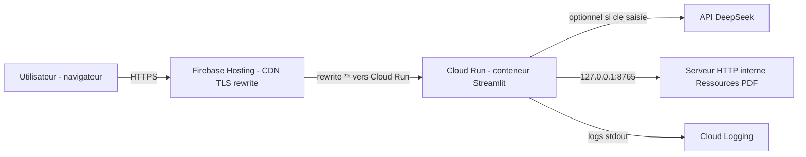
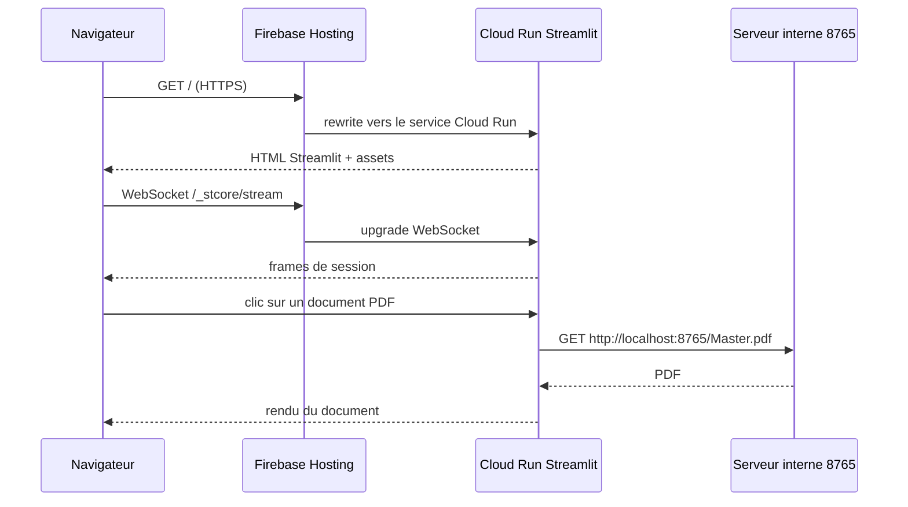
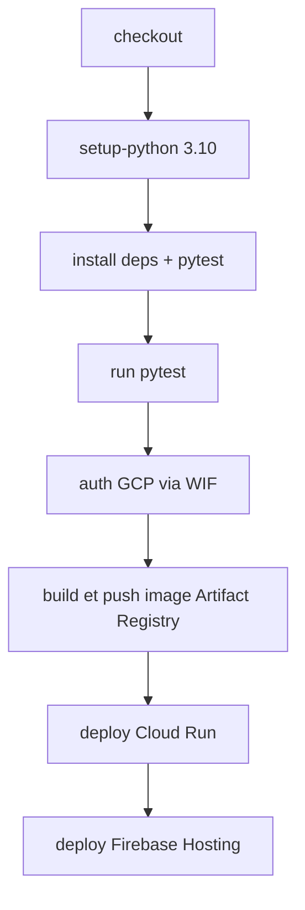

# Architecture de déploiement — AURA-Grid PoC

> **Statut** : document de conception (aucun code livré ici).
> **Périmètre** : déploiement de l'application Streamlit [`app.py`](../app.py:1) sur **Google Cloud Run**, exposée derrière **Firebase Hosting** (CDN + TLS + rewrite), avec automatisation **GitHub Actions**.
> **Public** : la sous-tâche Code qui implémentera les artefacts listés au § 3.

---

## 1. Vue d'ensemble

### 1.1 Nature de l'application

AURA-Grid est une application **Streamlit**, c'est-à-dire un **serveur Python** (pas un site statique) :

- Point d'entrée : [`app.py`](../app.py:1), lancé par `streamlit run app.py`.
- Dépendances : `streamlit>=1.30`, `openai>=1.0` ([`requirements.txt`](../requirements.txt:1)).
- Python **3.10+** requis ([`SPEC.md`](../SPEC.md:6)).
- Port par défaut **8501** ; [`.streamlit/config.toml`](../.streamlit/config.toml:23) définit `headless = true` mais **ni port ni adresse** → ils doivent être passés en ligne de commande.
- Aucune dépendance système (`apt`) : uniquement des paquets Python.
- **Aucun secret obligatoire** : la clé DeepSeek est saisie par l'utilisateur dans la sidebar et n'est jamais persistée. Le mode offline (Mode A) fonctionne sans clé.
- Le dossier [`Ressources/`](../Ressources/) (3 PDF) doit être **présent dans l'image** : l'app démarre un serveur HTTP interne sur `127.0.0.1:8765` pour les servir (voir [`_ensure_static_server()`](../app.py:696)).
- **Aucun test existant** (ni `pytest`, ni `unittest`, ni dossier `tests/`).

### 1.2 Topologie cible



Détail des flux :

1. Le navigateur appelle le domaine Firebase Hosting (`https://<project>.web.app` ou domaine custom).
2. Firebase Hosting termine le TLS, sert depuis le CDN, et **rewrite** toutes les requêtes (`**`) vers le service Cloud Run.
3. Cloud Run exécute le conteneur, qui lance Streamlit sur `0.0.0.0:$PORT`.
4. Streamlit ouvre un **WebSocket** avec le navigateur pour son protocole de session (voir § 2.3).
5. Si l'utilisateur a saisi une clé DeepSeek, le conteneur appelle l'API DeepSeek en sortie ; sinon tout reste offline.
6. Le serveur HTTP interne (`127.0.0.1:8765`) sert les PDF de `Ressources/` **au conteneur lui-même** (liens `http://localhost:8765/...`). Il n'est **pas** exposé publiquement.

### 1.3 Flux de requête détaillé



---

## 2. Choix techniques et justification

### 2.1 Pourquoi Cloud Run (conteneur) et pas Firebase Hosting statique

| Option | Verdict | Raison |
|---|---|---|
| Firebase Hosting **statique** seul | ❌ | Streamlit est un **serveur Python** avec WebSocket ; il ne peut pas être exporté en fichiers statiques. |
| App Engine / Cloud Functions | ⚠️ | Fonctionne mais moins adapté aux conteneurs longs et aux WebSockets ; configuration plus lourde. |
| **Cloud Run (conteneur)** | ✅ | Exécute un conteneur arbitraire, supporte HTTP/2 et WebSockets, scale-to-zero, `$PORT` injecté, révisions immuables (rollback natif). |
| **Firebase Hosting en frontal** | ✅ | CDN mondial, TLS managé, domaine custom simple, **rewrite** transparent vers Cloud Run, cache des assets statiques. |

**Décision** : Cloud Run héberge le conteneur Streamlit ; Firebase Hosting sert de **façade** (CDN/TLS/domaine) et **rewrite** tout le trafic vers Cloud Run. Cette combinaison est validée et retenue.

### 2.2 Gestion du port `$PORT`

Cloud Run injecte la variable d'environnement `PORT` (par défaut `8080`) et **exige** que le conteneur écoute sur ce port et sur `0.0.0.0`.

- [`.streamlit/config.toml`](../.streamlit/config.toml:23) ne fixe pas le port → il faut le passer en arguments.
- `CMD` du Dockerfile (forme shell pour l'expansion de `$PORT`) :

```dockerfile
CMD streamlit run app.py \
    --server.port=${PORT:-8080} \
    --server.address=0.0.0.0 \
    --server.headless=true
```

- `--server.address=0.0.0.0` est **indispensable** : sans cela Streamlit n'écoute que sur `127.0.0.1` et Cloud Run ne peut pas joindre le conteneur.
- Le serveur interne des PDF reste volontairement sur `127.0.0.1:8765` (voir [`_ensure_static_server()`](../app.py:696)) : il ne doit pas entrer en conflit avec `$PORT`.

### 2.3 WebSockets Streamlit derrière le proxy Firebase

Streamlit utilise un **WebSocket** (`/_stcore/stream`) pour son protocole de session. Points d'attention :

- **Cloud Run** supporte les WebSockets nativement (HTTP/2) ; prévoir un `--timeout` de requête suffisant (ex. `--timeout=3600`) et `--session-affinity` si plusieurs instances.
- **Firebase Hosting** proxifie les WebSockets via le rewrite ; il faut s'assurer que le rewrite `**` couvre `/_stcore/**` (c'est le cas avec `**`).
- **CORS / XSRF** : Streamlit applique par défaut une protection XSRF et un contrôle CORS. Derrière un proxy qui réécrit l'origine (domaine Firebase ≠ domaine Cloud Run), ces contrôles peuvent provoquer des erreurs `403`/`WebSocket closed`.
  - Option recommandée pour un **démonstrateur non sensible** : `--server.enableCORS=false --server.enableXsrfProtection=false`.
  - Alternative plus stricte : conserver XSRF et configurer `--server.enableCORS=true` avec une origine autorisée, mais cela complique le rewrite Firebase. **Retenir l'option permissive pour ce PoC**, en documentant le risque (voir § 9).
- **Health check** : Cloud Run sonde `GET /_stcore/health` (Streamlit expose cet endpoint) ; il renvoie `200 ok` sans WebSocket.

### 2.4 Sécurité d'accès au service Cloud Run

Deux modes possibles :

| Mode | Usage | Conséquence |
|---|---|---|
| `--allow-unauthenticated` | Démo publique via Firebase | Firebase Hosting peut atteindre le service sans jeton. **Retenu pour le PoC.** |
| `--no-allow-unauthenticated` | Service privé | Firebase Hosting ne peut pas s'authentifier nativement → nécessite un proxy authentifié ou IAP. Non retenu ici. |

**Décision** : `--allow-unauthenticated` pour le PoC, avec la protection XSRF désactivée assumée et documentée. Le service reste non sensible (données synthétiques, aucun secret persisté).

### 2.5 Région

- Choisir une région unique pour Cloud Run et Artifact Registry (ex. `europe-west1` ou `europe-west9`).
- Firebase Hosting est global (CDN) ; le rewrite pointe vers la région du service Cloud Run.
- Cohérence obligatoire entre `GCP_REGION` (workflow) et `region` dans [`firebase.json`](../firebase.json:1).

---

## 3. Artefacts à créer (liste exhaustive)

> Tous ces fichiers seront créés dans la **sous-tâche Code**. Aucun n'est créé ici.

### 3.1 `Dockerfile`

**Rôle** : construire l'image du conteneur Streamlit.

Paramètres principaux :

- Image de base : `python:3.10-slim`.
- `ENV PYTHONDONTWRITEBYTECODE=1`, `PYTHONUNBUFFERED=1`, `PIP_NO_CACHE_DIR=1`.
- `WORKDIR /app`.
- Copier `requirements.txt` puis `pip install --no-cache-dir -r requirements.txt` (couche cache).
- Copier `app.py`, `.streamlit/`, `Ressources/`.
- `EXPOSE 8080` (documentaire).
- `CMD` shell avec `${PORT:-8080}`, `--server.address=0.0.0.0`, `--server.headless=true`, `--server.enableCORS=false`, `--server.enableXsrfProtection=false`.
- Utilisateur non-root recommandé (`useradd` + `USER app`).

### 3.2 `.dockerignore`

**Rôle** : réduire le contexte de build et éviter de copier des fichiers inutiles/sensibles.

Contenu principal : `.git/`, `.github/`, `.venv/`, `__pycache__/`, `*.pyc`, `.pytest_cache/`, `tests/`, `docs/`, `.cursor/`, `.roo/`, `scripts/`, `*.md`, `.env*`, `.gitignore`.

> **Attention** : ne **pas** exclure `Ressources/` ni `.streamlit/` (nécessaires au runtime).

### 3.3 `firebase.json`

**Rôle** : configurer Firebase Hosting avec rewrite vers Cloud Run.

Paramètres principaux :

- `hosting.public` : un dossier placeholder (ex. `public/` contenant un `index.html` minimal ou un `.gitkeep`), car Firebase exige un répertoire public même en rewrite total.
- `hosting.ignore` : `firebase.json`, `**/.*`, `**/node_modules/**`.
- `hosting.rewrites` : une règle `{ "source": "**", "run": { "serviceId": "<SERVICE_NAME>", "region": "<GCP_REGION>" } }`.
- `hosting.headers` optionnels (cache des assets `/_stcore/static/**`).

### 3.4 `.firebaserc`

**Rôle** : associer un alias de projet Firebase.

Paramètres : `{ "projects": { "default": "<FIREBASE_PROJECT_ID>" } }` (placeholder à remplacer).

### 3.5 `.github/workflows/deploy.yml`

**Rôle** : pipeline CI/CD (voir § 5).

### 3.6 `tests/` + `pytest`

**Rôle** : introduire une base de tests minimale (voir § 4), car « lancer les tests » est demandé alors qu'aucun test n'existe.

Fichiers prévus :

- `tests/test_arbitrate.py` : tests unitaires du noyau déterministe [`arbitrate()`](../app.py:532).
- `tests/test_smoke.py` : smoke test d'import de [`app.py`](../app.py:1).
- `pytest` ajouté aux dépendances de CI (fichier `requirements-dev.txt` ou installation directe dans le workflow).

### 3.7 (Optionnel) `requirements-dev.txt`

**Rôle** : isoler `pytest` des dépendances runtime. Alternative : `pip install pytest` directement dans le workflow.

---

## 4. Stratégie de tests

Aucun test n'existe aujourd'hui. Le plan minimal suivant sera **implémenté dans la sous-tâche Code** :

### 4.1 Tests unitaires du noyau déterministe `arbitrate()`

[`arbitrate()`](../app.py:532) est pur (aucun LLM, aucun réseau, aucun aléatoire) : c'est la cible idéale.

Cas à couvrir (règles R1 → R6) :

| Cas | Entrée | Verdict attendu |
|---|---|---|
| R1 Veto réglementaire | Regulatory = `REJECT` | `REGULATORY_VETO` |
| R2 Échec total | 3 × `TIMEOUT` | `SYSTEM_FAILURE_ESCALATION` |
| R3 Consensus dégradé | 1 `TIMEOUT` + 2 `APPROVE` | `DEGRADED_CONSENSUS` |
| R3 Conflit dégradé | 1 `TIMEOUT` + `APPROVE`/`REJECT` | `DEGRADED_CONFLICT` |
| R4 Consensus | 3 × `APPROVE` | `CONSENSUS_APPROVED` |
| R5 Rejet unanime | 3 × `REJECT` | `UNANIMOUS_REJECT` |
| R6 Conflit inter-agents | `APPROVE`/`REJECT` sans veto | `INTER_AGENT_CONFLICT` |
| Déterminisme | même entrée 2× | verdict identique |

### 4.2 Smoke test d'import

- `import app` doit réussir sans clé API et sans lancer de serveur.
- Vérifier la présence des constantes clés (`AGENT_ORDER`, `VERDICTS`, `VERDICT_META`).
- Ne **pas** appeler [`main()`](../app.py:1025) (qui exécute `st.set_page_config`).

### 4.3 Commande CI

```bash
pytest -q
```

Exécutée dans le workflow **avant** le build de l'image (fail-fast).

---

## 5. Workflow CI/CD GitHub Actions

Fichier : [`.github/workflows/deploy.yml`](../.github/workflows/deploy.yml:1)

### 5.1 Déclencheurs

```yaml
on:
  push:
    branches: [main]
  workflow_dispatch:
```

### 5.2 Permissions

```yaml
permissions:
  contents: read
  id-token: write   # requis pour Workload Identity Federation (OIDC)
```

### 5.3 Étapes



Détail :

1. **checkout** : `actions/checkout@v4`.
2. **setup-python** : `actions/setup-python@v5` avec `python-version: '3.10'`.
3. **install deps** : `pip install -r requirements.txt pytest`.
4. **run tests** : `pytest -q`.
5. **auth GCP** : `google-github-actions/auth@v2` avec `workload_identity_provider` et `service_account` (recommandé). Alternative : `credentials_json` depuis un secret.
6. **build & push** : `docker build` + `docker push` vers Artifact Registry (`<region>-docker.pkg.dev/<project>/<repo>/aura-grid:<sha>`). Alternative simplifiée : `gcloud run deploy --source .`.
7. **deploy Cloud Run** : `gcloud run deploy <service> --image <image> --region <region> --allow-unauthenticated --port 8080 --timeout 3600 --session-affinity`.
8. **deploy Firebase Hosting** : `FirebaseExtended/action-hosting-deploy@v0` (avec `firebaseServiceAccount`, `projectId`, `channelId: live`) ou `firebase deploy --only hosting`.

---

## 6. Secrets et variables GitHub requis

| Nom | Type | Rôle | Génération |
|---|---|---|---|
| `GCP_PROJECT_ID` | variable | ID du projet GCP | Console GCP |
| `GCP_REGION` | variable | Région Cloud Run / Artifact Registry | ex. `europe-west1` |
| `GCP_SERVICE_NAME` | variable | Nom du service Cloud Run | ex. `aura-grid` |
| `GCP_ARTIFACT_REPO` | variable | Dépôt Artifact Registry | `gcloud artifacts repositories create` |
| `GCP_WORKLOAD_IDENTITY_PROVIDER` | secret | Provider WIF (OIDC) | `gcloud iam workload-identity-pools ...` |
| `GCP_SERVICE_ACCOUNT` | secret | SA de déploiement (email) | `gcloud iam service-accounts create` |
| `FIREBASE_PROJECT_ID` | variable | ID projet Firebase | Console Firebase |
| `FIREBASE_SERVICE_ACCOUNT` | secret | JSON du SA pour Firebase | Console GCP → clé JSON (ou WIF si supporté) |

Notes :

- **Workload Identity Federation** est recommandé : pas de clé JSON longue durée, `id-token: write` suffit.
- Si l'on utilise une clé de service account (alternative), la stocker en secret GitHub et la révoquer régulièrement.
- `FIREBASE_SERVICE_ACCOUNT` peut être remplacé par un token (`FIREBASE_TOKEN` via `firebase login:ci`), moins recommandé.

---

## 7. Prérequis côté GCP / Firebase

1. **Activer les APIs** :
   - `run.googleapis.com`
   - `artifactregistry.googleapis.com`
   - `firebasehosting.googleapis.com`
   - `iamcredentials.googleapis.com` (WIF)
2. **Créer le dépôt Artifact Registry** (Docker, région = `GCP_REGION`).
3. **Créer le service Cloud Run** (premier déploiement manuel, voir § 8).
4. **Lier Firebase Hosting → Cloud Run** : le rewrite dans [`firebase.json`](../firebase.json:1) référence `serviceId` et `region` ; Firebase doit avoir les droits d'invoquer le service (service public `--allow-unauthenticated`).
5. **Domaine** : utiliser le domaine par défaut `*.web.app` ou connecter un domaine custom dans la console Firebase.
6. **Service Account de déploiement** : rôles `roles/run.admin`, `roles/artifactregistry.writer`, `roles/iam.serviceAccountUser`, `roles/firebasehosting.admin`.

---

## 8. Procédure de premier déploiement manuel (bootstrap)

1. **Build local** : `docker build -t aura-grid .`
2. **Test local** : `docker run -p 8080:8080 -e PORT=8080 aura-grid` puis ouvrir `http://localhost:8080`.
3. **Push image** : `docker tag` + `docker push` vers Artifact Registry.
4. **Déployer Cloud Run** :
   ```bash
   gcloud run deploy aura-grid \
     --image <region>-docker.pkg.dev/<project>/<repo>/aura-grid:latest \
     --region <region> --allow-unauthenticated --port 8080 --timeout 3600
   ```
5. **Initialiser Firebase** : `firebase init hosting` (ou créer [`firebase.json`](../firebase.json:1) et [`.firebaserc`](../.firebaserc:1) manuellement).
6. **Déployer Hosting** : `firebase deploy --only hosting`.
7. **Vérifier** : ouvrir l'URL Firebase, tester le WebSocket et l'ouverture d'un PDF.
8. **Automatiser** : configurer les secrets GitHub (§ 6) et pousser sur `main` pour déclencher le workflow.

---

## 9. Rollback et bonnes pratiques

### 9.1 Rollback Cloud Run

- Chaque déploiement crée une **révision immuable** (`aura-grid-00001`, `00002`, …).
- Rollback immédiat : `gcloud run services update-traffic aura-grid --to-revisions <REVISION>=100`.
- Conserver les images taguées par **SHA de commit** (pas seulement `latest`) pour redéployer une version exacte.

### 9.2 Bonnes pratiques

- **Tags d'image** : `:<git-sha>` + `:latest` ; ne jamais déployer uniquement `latest` en production.
- **`--no-allow-unauthenticated`** : à envisager si le service doit être privé (nécessite alors un proxy authentifié devant Firebase, ou IAP).
- **XSRF/CORS** : la désactivation est acceptable pour ce PoC non sensible ; pour un usage réel, réactiver XSRF et restreindre les origines.
- **Ressources** : `--memory 512Mi --cpu 1` suffisent ; ajuster selon la charge.
- **Scale** : `--min-instances 0` (scale-to-zero) pour le coût ; `--max-instances` pour borner.
- **Logs** : Streamlit écrit sur stdout → visibles dans Cloud Logging.
- **Secrets** : aucun secret n'est stocké dans l'image ; la clé DeepSeek reste côté utilisateur.
- **Health check** : `/ _stcore/health` doit répondre `200` (vérifier après déploiement).

---

## 10. Récapitulatif des décisions

| Décision | Choix |
|---|---|
| Hébergement applicatif | Cloud Run (conteneur) |
| Façade / CDN / TLS | Firebase Hosting avec rewrite `**` |
| Port | `$PORT` via `--server.port=${PORT:-8080}` |
| Adresse d'écoute | `0.0.0.0` |
| WebSockets | Supportés Cloud Run + rewrite Firebase |
| XSRF/CORS | Désactivés pour le PoC (documenté) |
| Accès service | `--allow-unauthenticated` |
| CI/CD | GitHub Actions + Workload Identity Federation |
| Tests | `pytest` sur `arbitrate()` + smoke test d'import |
| Rollback | Révisions Cloud Run + tags SHA |
