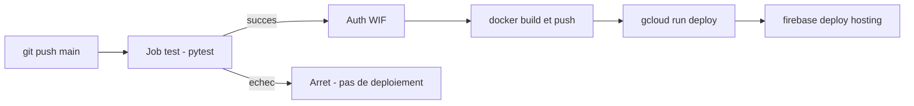

# Guide de déploiement pas-à-pas — AURA-Grid PoC

> ## ⚠️ Mode actuellement déployé : 100 % gratuit (Firebase Hosting Spark)
>
> Le projet GCP `e-learning-labo` **n'a pas de compte de facturation** attaché.
> Cloud Run, Artifact Registry et Cloud Build exigent la facturation activée
> (même pour rester dans le free tier), donc le déploiement Cloud Run est
> **impossible en l'état**.
>
> Le déploiement effectif est donc **statique** :
> - [`firebase.json`](../firebase.json:1) ne contient **plus** de bloc `rewrites` Cloud Run ;
> - seul le contenu de [`public/`](../public/index.html:1) est publié sur Firebase Hosting ;
> - le workflow [`.github/workflows/deploy.yml`](../.github/workflows/deploy.yml:1) ne fait plus que `test` + `Firebase Hosting` ;
> - URL live : <https://e-learning-labo.web.app>.
>
> Les sections ci-dessous décrivent le déploiement **complet Cloud Run** : elles
> restent valables **une fois la facturation activée** (il faudra alors restaurer
> le bloc `rewrites` de `firebase.json` et les étapes Cloud Run du workflow).

> **Objectif** : héberger l'application Streamlit AURA-Grid sur **Google Cloud Run**, exposée derrière **Firebase Hosting**, avec automatisation **GitHub Actions**.
> **Public** : la personne qui exécute réellement le déploiement sur son propre projet GCP/Firebase.
> **Complément** : ce guide est **opérationnel** (commandes concrètes + checklist). Pour la *justification* des choix techniques (Cloud Run vs statique, gestion de `$PORT`, WebSockets, CORS/XSRF, sécurité), voir [`docs/DEPLOYMENT_ARCHITECTURE.md`](DEPLOYMENT_ARCHITECTURE.md:1).

---

## Sommaire

1. [Prérequis](#1-prérequis)
2. [Étape 1 — Activer les APIs](#2-étape-1--activer-les-apis)
3. [Étape 2 — Créer le dépôt Artifact Registry](#3-étape-2--créer-le-dépôt-artifact-registry)
4. [Étape 3 — Créer le service account de déploiement](#4-étape-3--créer-le-service-account-de-déploiement)
5. [Étape 4 — Configurer Workload Identity Federation](#5-étape-4--configurer-workload-identity-federation)
6. [Étape 5 — Créer la clé JSON du service account Firebase](#6-étape-5--créer-la-clé-json-du-service-account-firebase)
7. [Étape 6 — Renseigner les variables et secrets GitHub](#7-étape-6--renseigner-les-variables-et-secrets-github)
8. [Étape 7 — Remplacer le placeholder `.firebaserc`](#8-étape-7--remplacer-le-placeholder-firebaserc)
9. [Étape 8 — Premier déploiement manuel (bootstrap)](#9-étape-8--premier-déploiement-manuel-bootstrap)
10. [Étape 9 — Automatisation (push sur `main`)](#10-étape-9--automatisation-push-sur-main)
11. [Vérification post-déploiement](#11-vérification-post-déploiement)
12. [Dépannage](#12-dépannage)
13. [Rollback](#13-rollback)
14. [Coûts et bonnes pratiques](#14-coûts-et-bonnes-pratiques)
15. [Checklist finale](#15-checklist-finale)

---

## Conventions et placeholders

Tout au long du guide, remplacez les placeholders suivants par vos valeurs réelles :

| Placeholder | Signification | Exemple |
|---|---|---|
| `<PROJECT_ID>` | ID du projet Google Cloud (et Firebase) | `mon-projet-123` |
| `<PROJECT_NUMBER>` | Numéro du projet GCP (visible dans la console) | `123456789012` |
| `<REGION>` | Région Cloud Run / Artifact Registry | `europe-west1` |
| `<SERVICE_NAME>` | Nom du service Cloud Run | `aura-grid-poc` |
| `<ARTIFACT_REPO>` | Nom du dépôt Artifact Registry | `aura-grid-repo` |
| `<GITHUB_ORG>` | Organisation ou utilisateur GitHub | `mon-org` |
| `<GITHUB_REPO>` | Nom du dépôt GitHub | `aura-grid-poc` |
| `<SA_NAME>` | Nom court du service account de déploiement | `gh-deployer` |
| `<SA_EMAIL>` | Email complet du service account | `gh-deployer@mon-projet-123.iam.gserviceaccount.com` |
| `<POOL_ID>` | ID du pool Workload Identity | `github-pool` |
| `<PROVIDER_ID>` | ID du provider OIDC GitHub | `github-provider` |

> **Important** : `<SERVICE_NAME>` et `<REGION>` doivent correspondre **exactement** au `serviceId` et au `region` de [`firebase.json`](../firebase.json:1) (`aura-grid-poc` / `europe-west1`). Si vous changez l'un, mettez à jour l'autre.

Définissez une fois pour toutes vos variables de shell pour alléger les commandes :

```bash
export PROJECT_ID="<PROJECT_ID>"
export PROJECT_NUMBER="<PROJECT_NUMBER>"
export REGION="europe-west1"
export SERVICE_NAME="aura-grid-poc"
export ARTIFACT_REPO="aura-grid-repo"
export SA_NAME="gh-deployer"
export SA_EMAIL="${SA_NAME}@${PROJECT_ID}.iam.gserviceaccount.com"
export POOL_ID="github-pool"
export PROVIDER_ID="github-provider"
export GITHUB_ORG="<GITHUB_ORG>"
export GITHUB_REPO="<GITHUB_REPO>"

gcloud config set project "$PROJECT_ID"
```

---

## 1. Prérequis

### 1.1 Outils à installer

| Outil | Usage | Installation |
|---|---|---|
| **Google Cloud SDK** (`gcloud`) | APIs, IAM, WIF, Cloud Run, Artifact Registry | <https://cloud.google.com/sdk/docs/install> |
| **firebase-tools** (`firebase`) | Déploiement Firebase Hosting | `npm install -g firebase-tools` |
| **Docker** | Build et test local de l'image | <https://docs.docker.com/get-docker/> |
| **Git** | Versionner et déclencher le workflow | <https://git-scm.com/> |

Vérifiez les versions :

```bash
gcloud --version
firebase --version
docker --version
git --version
```

### 1.2 Projet et facturation

- Un **projet Google Cloud** existant, avec **Firebase ajouté** (console Firebase → « Ajouter un projet » ou sélection du projet GCP existant).
- La **facturation activée** sur le projet (Cloud Run et Artifact Registry en dépendent, même en restant dans le free tier).
- Un **dépôt GitHub** contenant ce code, avec la branche `main`.

```bash
# Vérifier que la facturation est bien liée
gcloud billing projects describe "$PROJECT_ID"
```

### 1.3 Authentification locale

```bash
gcloud auth login
gcloud auth application-default login
firebase login
```

> Le workflow GitHub n'utilise **pas** ces identifiants : il s'authentifie via Workload Identity Federation (étape 4). L'authentification locale ne sert qu'au **bootstrap manuel** (étape 8).

---

## 2. Étape 1 — Activer les APIs

```bash
gcloud services enable \
  run.googleapis.com \
  artifactregistry.googleapis.com \
  cloudbuild.googleapis.com \
  iam.googleapis.com \
  iamcredentials.googleapis.com \
  firebasehosting.googleapis.com \
  --project "$PROJECT_ID"
```

| API | Rôle |
|---|---|
| `run.googleapis.com` | Hébergement du conteneur Streamlit |
| `artifactregistry.googleapis.com` | Stockage des images Docker |
| `cloudbuild.googleapis.com` | Build serveur optionnel (le workflow build en local sur le runner, mais utile pour `gcloud run deploy --source`) |
| `iam.googleapis.com` / `iamcredentials.googleapis.com` | Service accounts et Workload Identity Federation |
| `firebasehosting.googleapis.com` | Façade CDN/TLS + rewrite |

Vérification :

```bash
gcloud services list --enabled --project "$PROJECT_ID" \
  | grep -E "run|artifactregistry|cloudbuild|firebasehosting"
```

---

## 3. Étape 2 — Créer le dépôt Artifact Registry

Format **Docker**, dans la même région que Cloud Run :

```bash
gcloud artifacts repositories create "$ARTIFACT_REPO" \
  --repository-format=docker \
  --location="$REGION" \
  --description="Images Docker AURA-Grid PoC" \
  --project "$PROJECT_ID"
```

Vérification :

```bash
gcloud artifacts repositories list --location="$REGION" --project "$PROJECT_ID"
```

L'URL de base des images sera :

```
<REGION>-docker.pkg.dev/<PROJECT_ID>/<ARTIFACT_REPO>/<SERVICE_NAME>:<TAG>
```

Exemple : `europe-west1-docker.pkg.dev/mon-projet-123/aura-grid-repo/aura-grid-poc:<sha>`

---

## 4. Étape 3 — Créer le service account de déploiement

Ce service account est **usurpé par GitHub Actions** (via WIF) pour pousser l'image et déployer.

### 4.1 Création

```bash
gcloud iam service-accounts create "$SA_NAME" \
  --display-name="GitHub Actions deployer (AURA-Grid)" \
  --project "$PROJECT_ID"
```

### 4.2 Attribution des rôles minimaux

```bash
# Déployer / mettre à jour le service Cloud Run
gcloud projects add-iam-policy-binding "$PROJECT_ID" \
  --member="serviceAccount:${SA_EMAIL}" \
  --role="roles/run.admin"

# Agir en tant que service account d'exécution Cloud Run
gcloud projects add-iam-policy-binding "$PROJECT_ID" \
  --member="serviceAccount:${SA_EMAIL}" \
  --role="roles/iam.serviceAccountUser"

# Pousser les images vers Artifact Registry
gcloud projects add-iam-policy-binding "$PROJECT_ID" \
  --member="serviceAccount:${SA_EMAIL}" \
  --role="roles/artifactregistry.writer"

# Nécessaire si Cloud Build est utilisé (build serveur / staging bucket)
gcloud projects add-iam-policy-binding "$PROJECT_ID" \
  --member="serviceAccount:${SA_EMAIL}" \
  --role="roles/storage.admin"
```

| Rôle | Justification |
|---|---|
| `roles/run.admin` | `gcloud run deploy`, gestion des révisions et du trafic |
| `roles/iam.serviceAccountUser` | Permet à Cloud Run d'utiliser le SA d'exécution |
| `roles/artifactregistry.writer` | `docker push` vers le dépôt |
| `roles/storage.admin` | Bucket de staging Cloud Build (optionnel si build 100 % local) |

> **Principe du moindre privilège** : ces rôles sont accordés au niveau **projet** pour simplifier. En production, restreignez-les à la ressource concernée (ex. `roles/run.admin` sur le service uniquement) via des IAM conditions.

Vérification :

```bash
gcloud projects get-iam-policy "$PROJECT_ID" \
  --flatten="bindings[].members" \
  --filter="bindings.members:${SA_EMAIL}" \
  --format="table(bindings.role)"
```

---

## 5. Étape 4 — Configurer Workload Identity Federation

WIF permet à GitHub Actions d'obtenir des identifiants GCP **sans clé JSON longue durée** (OIDC).

### 5.1 Créer le pool et le provider OIDC GitHub

```bash
# Pool
gcloud iam workload-identity-pools create "$POOL_ID" \
  --location="global" \
  --display-name="GitHub Actions Pool" \
  --project "$PROJECT_ID"

# Provider OIDC GitHub
gcloud iam workload-identity-pools providers create-oidc "$PROVIDER_ID" \
  --location="global" \
  --workload-identity-pool="$POOL_ID" \
  --display-name="GitHub OIDC Provider" \
  --issuer-uri="https://token.actions.githubusercontent.com" \
  --attribute-mapping="google.subject=assertion.sub,attribute.repository=assertion.repository,attribute.repository_owner=assertion.repository_owner" \
  --attribute-condition="assertion.repository=='${GITHUB_ORG}/${GITHUB_REPO}'" \
  --project "$PROJECT_ID"
```

> L'`attribute-condition` **restreint** l'usurpation au seul dépôt `${GITHUB_ORG}/${GITHUB_REPO}`. Sans elle, n'importe quel dépôt GitHub pourrait s'authentifier.

### 5.2 Autoriser le dépôt GitHub à usurper le service account

```bash
gcloud iam service-accounts add-iam-policy-binding "$SA_EMAIL" \
  --role="roles/iam.workloadIdentityUser" \
  --member="principalSet://iam.googleapis.com/projects/${PROJECT_NUMBER}/locations/global/workloadIdentityPools/${POOL_ID}/attribute.repository/${GITHUB_ORG}/${GITHUB_REPO}" \
  --project "$PROJECT_ID"
```

### 5.3 Récupérer la valeur `GCP_WORKLOAD_IDENTITY_PROVIDER`

Le secret attendu par le workflow a le format :

```
projects/<PROJECT_NUMBER>/locations/global/workloadIdentityPools/<POOL_ID>/providers/<PROVIDER_ID>
```

Deux façons de l'obtenir :

```bash
# Méthode 1 : affichage direct du nom complet du provider
gcloud iam workload-identity-pools providers describe "$PROVIDER_ID" \
  --location="global" \
  --workload-identity-pool="$POOL_ID" \
  --project "$PROJECT_ID" \
  --format="value(name)"

# Méthode 2 : construction manuelle (si vous connaissez PROJECT_NUMBER)
echo "projects/${PROJECT_NUMBER}/locations/global/workloadIdentityPools/${POOL_ID}/providers/${PROVIDER_ID}"
```

Copiez la sortie : c'est la valeur du secret **`GCP_WORKLOAD_IDENTITY_PROVIDER`** (étape 6).

> Le `PROJECT_NUMBER` se récupère avec : `gcloud projects describe "$PROJECT_ID" --format="value(projectNumber)"`.

---

## 6. Étape 5 — Créer la clé JSON du service account Firebase

Le workflow utilise `FirebaseExtended/action-hosting-deploy`, qui s'authentifie via une **clé JSON de service account** (secret `FIREBASE_SERVICE_ACCOUNT`).

### 6.1 Créer (ou réutiliser) un service account Firebase

```bash
gcloud iam service-accounts create firebase-deployer \
  --display-name="Firebase Hosting deployer" \
  --project "$PROJECT_ID"

gcloud projects add-iam-policy-binding "$PROJECT_ID" \
  --member="serviceAccount:firebase-deployer@${PROJECT_ID}.iam.gserviceaccount.com" \
  --role="roles/firebasehosting.admin"
```

### 6.2 Générer la clé JSON

```bash
gcloud iam service-accounts keys create firebase-key.json \
  --iam-account="firebase-deployer@${PROJECT_ID}.iam.gserviceaccount.com" \
  --project "$PROJECT_ID"
```

Le fichier `firebase-key.json` contient la clé privée : **ne le commitez jamais**.

### 6.3 Avertissement sécurité

- **Ne jamais** versionner `firebase-key.json` (vérifiez qu'il est ignoré par [`.gitignore`](../.gitignore:1)).
- Stockez son **contenu intégral** dans le secret GitHub `FIREBASE_SERVICE_ACCOUNT` (étape 6).
- **Rotation** : supprimez la clé après usage local et faites-la tourner périodiquement.
  ```bash
  # Lister les clés
  gcloud iam service-accounts keys list \
    --iam-account="firebase-deployer@${PROJECT_ID}.iam.gserviceaccount.com"
  # Supprimer une clé compromise
  gcloud iam service-accounts keys delete <KEY_ID> \
    --iam-account="firebase-deployer@${PROJECT_ID}.iam.gserviceaccount.com"
  ```
- Supprimez le fichier local une fois le secret renseigné :
  ```bash
  rm firebase-key.json   # bash / macOS / Linux
  del firebase-key.json  # Windows cmd
  ```

---

## 7. Étape 6 — Renseigner les variables et secrets GitHub

Rendez-vous dans **GitHub → votre dépôt → Settings → Secrets and variables → Actions**.

### 7.1 Variables (onglet *Variables*)

| Nom | Type | Valeur / comment l'obtenir |
|---|---|---|
| `GCP_PROJECT_ID` | Variable | `<PROJECT_ID>` |
| `GCP_REGION` | Variable | `europe-west1` (doit correspondre à [`firebase.json`](../firebase.json:1)) |
| `GCP_SERVICE_NAME` | Variable | `aura-grid-poc` (doit correspondre au `serviceId` de [`firebase.json`](../firebase.json:1)) |
| `GCP_ARTIFACT_REPO` | Variable | `<ARTIFACT_REPO>` (créé à l'étape 2) |
| `FIREBASE_PROJECT_ID` | Variable | `<PROJECT_ID>` (projet Firebase Hosting) |

### 7.2 Secrets (onglet *Secrets*)

| Nom | Type | Valeur / comment l'obtenir |
|---|---|---|
| `GCP_WORKLOAD_IDENTITY_PROVIDER` | Secret | Sortie de l'étape 5.3 (`projects/<NUM>/locations/global/workloadIdentityPools/<POOL>/providers/<PROVIDER>`) |
| `GCP_SERVICE_ACCOUNT` | Secret | `<SA_EMAIL>` (ex. `gh-deployer@mon-projet-123.iam.gserviceaccount.com`) |
| `FIREBASE_SERVICE_ACCOUNT` | Secret | **Contenu intégral** du fichier `firebase-key.json` (étape 5.2) |

> `GITHUB_TOKEN` est fourni automatiquement par GitHub : ne le créez pas.

### 7.3 Saisie via la CLI `gh` (optionnel)

```bash
# Variables
gh variable set GCP_PROJECT_ID     --body "$PROJECT_ID"
gh variable set GCP_REGION         --body "$REGION"
gh variable set GCP_SERVICE_NAME   --body "$SERVICE_NAME"
gh variable set GCP_ARTIFACT_REPO  --body "$ARTIFACT_REPO"
gh variable set FIREBASE_PROJECT_ID --body "$PROJECT_ID"

# Secrets
gh secret set GCP_WORKLOAD_IDENTITY_PROVIDER --body "projects/${PROJECT_NUMBER}/locations/global/workloadIdentityPools/${POOL_ID}/providers/${PROVIDER_ID}"
gh secret set GCP_SERVICE_ACCOUNT --body "$SA_EMAIL"
gh secret set FIREBASE_SERVICE_ACCOUNT < firebase-key.json
```

---

## 8. Étape 7 — Remplacer le placeholder `.firebaserc`

Le fichier [`.firebaserc`](../.firebaserc:1) contient actuellement :

```json
{
  "projects": {
    "default": "REPLACE_WITH_FIREBASE_PROJECT_ID"
  }
}
```

Deux options :

**Option A — remplacer le placeholder** (utile pour les déploiements `firebase` en local) :

```json
{
  "projects": {
    "default": "<PROJECT_ID>"
  }
}
```

**Option B — ne rien changer** : le workflow passe explicitement `projectId: ${{ vars.FIREBASE_PROJECT_ID }}` à `FirebaseExtended/action-hosting-deploy` ([`.github/workflows/deploy.yml`](../.github/workflows/deploy.yml:131)), ce qui **surcharge** la valeur de `.firebaserc`. Le placeholder n'a donc pas d'impact sur la CI.

> **Recommandation** : appliquez l'option A pour que les commandes `firebase deploy` manuelles (étape 8) fonctionnent sans `--project`.

---

## 9. Étape 8 — Premier déploiement manuel (bootstrap)

Le premier déploiement manuel valide toute la chaîne avant de s'appuyer sur la CI.

### 9.1 Build local de l'image

```bash
docker build -t "${SERVICE_NAME}:local" .
```

### 9.2 Test local du conteneur

```bash
docker run --rm -p 8080:8080 -e PORT=8080 "${SERVICE_NAME}:local"
```

Puis, dans un autre terminal :

```bash
curl -i http://localhost:8080/_stcore/health
# Attendu : HTTP/1.1 200 OK et corps "ok"
```

Ouvrez <http://localhost:8080> pour vérifier l'interface Streamlit.

### 9.3 Taguer et pousser vers Artifact Registry

```bash
# Authentifier Docker auprès d'Artifact Registry
gcloud auth configure-docker "${REGION}-docker.pkg.dev" --quiet

export IMAGE="${REGION}-docker.pkg.dev/${PROJECT_ID}/${ARTIFACT_REPO}/${SERVICE_NAME}:bootstrap"

docker tag "${SERVICE_NAME}:local" "$IMAGE"
docker push "$IMAGE"
```

### 9.4 Déployer sur Cloud Run

```bash
gcloud run deploy "$SERVICE_NAME" \
  --image "$IMAGE" \
  --region "$REGION" \
  --platform managed \
  --allow-unauthenticated \
  --port 8080 \
  --timeout 3600 \
  --session-affinity \
  --set-env-vars STREAMLIT_SERVER_HEADLESS=true \
  --project "$PROJECT_ID"
```

> Ces options reproduisent celles du workflow ([`.github/workflows/deploy.yml`](../.github/workflows/deploy.yml:116)). `--session-affinity` et `--timeout 3600` sont importants pour les WebSockets Streamlit.

Récupérez l'URL du service :

```bash
gcloud run services describe "$SERVICE_NAME" \
  --region "$REGION" \
  --format="value(status.url)" \
  --project "$PROJECT_ID"
```

Vérifiez le health check sur l'URL Cloud Run :

```bash
curl -i "$(gcloud run services describe "$SERVICE_NAME" --region "$REGION" --format='value(status.url)')/_stcore/health"
```

### 9.5 Déployer Firebase Hosting

```bash
firebase deploy --only hosting --project "$PROJECT_ID"
```

Firebase affiche l'URL de hosting (ex. `https://<PROJECT_ID>.web.app`). Le rewrite `**` → Cloud Run prend le relais.

### 9.6 Vérification finale du bootstrap

```bash
# Health check via Firebase Hosting (doit renvoyer 200 ok)
curl -i "https://${PROJECT_ID}.web.app/_stcore/health"
```

Ouvrez `https://<PROJECT_ID>.web.app` : l'application Streamlit doit s'afficher (et non la page de secours [`public/index.html`](../public/index.html:1)).

---

## 10. Étape 9 — Automatisation (push sur `main`)

Une fois le bootstrap validé, la CI prend le relais.

### 10.1 Déclencheurs

D'après [`.github/workflows/deploy.yml`](../.github/workflows/deploy.yml:42) :

- **`push` sur `main`** → job `test` (pytest) puis job `deploy`.
- **`workflow_dispatch`** → déclenchement manuel depuis l'onglet *Actions*.

Le job `deploy` ne s'exécute que si `test` réussit **et** que la ref est `refs/heads/main`.

### 10.2 Ce que fait le pipeline



### 10.3 Suivre l'exécution

1. GitHub → onglet **Actions** → workflow **CI/CD — Deploy AURA-Grid**.
2. Ouvrez le run : les jobs `Test (pytest)` et `Deploy (Cloud Run + Firebase Hosting)` s'affichent.
3. En cas d'échec, dépliez l'étape fautive pour lire les logs.

### 10.4 Lancer un déploiement manuel depuis GitHub

```bash
gh workflow run "CI/CD — Deploy AURA-Grid" --ref main
```

---

## 11. Vérification post-déploiement

| Vérification | Commande / action | Résultat attendu |
|---|---|---|
| URL Firebase Hosting | Ouvrir `https://<PROJECT_ID>.web.app` | Interface Streamlit |
| Health check | `curl -i https://<PROJECT_ID>.web.app/_stcore/health` | `200 ok` |
| Révision active | `gcloud run services describe "$SERVICE_NAME" --region "$REGION" --format="value(status.latestReadyRevisionName)"` | Nom de révision récent |
| Logs Cloud Run | `gcloud run services logs read "$SERVICE_NAME" --region "$REGION" --limit 50` | Démarrage Streamlit sans erreur |
| Logs en temps réel | `gcloud run services logs tail "$SERVICE_NAME" --region "$REGION"` | Flux continu |

```bash
# Exemple : lire les 50 dernières lignes de logs
gcloud run services logs read "$SERVICE_NAME" \
  --region "$REGION" \
  --limit 50 \
  --project "$PROJECT_ID"
```

---

## 12. Dépannage

| Symptôme | Cause probable | Piste de résolution |
|---|---|---|
| `Permission 'iam.serviceAccounts.getAccessToken' denied` / échec d'auth WIF | Binding `roles/iam.workloadIdentityUser` manquant ou `attribute-condition` trop stricte | Rejouer l'étape 5.2 ; vérifier que `GITHUB_ORG/GITHUB_REPO` correspond exactement ; vérifier le format du provider (secret) |
| `Invalid value for workload_identity_provider` | Format du secret incorrect | Doit être `projects/<NUM>/locations/global/workloadIdentityPools/<POOL>/providers/<PROVIDER>` (étape 5.3) |
| Page de secours [`public/index.html`](../public/index.html:1) affichée | Rewrite non pris en compte / service Cloud Run absent | Vérifier que le service `<SERVICE_NAME>` existe dans `<REGION>` ; vérifier `serviceId`/`region` dans [`firebase.json`](../firebase.json:1) ; redéployer hosting |
| `404` sur `/_stcore/health` via Firebase | Rewrite `**` non appliqué ou mauvais service | Contrôler [`firebase.json`](../firebase.json:1) ; vérifier l'URL Cloud Run directement |
| WebSocket ne se connecte pas (`WebSocket closed`, spinner infini) | CORS/XSRF ou timeout trop court | Le Dockerfile désactive déjà CORS/XSRF ([`Dockerfile`](../Dockerfile:1)) ; vérifier `--timeout 3600` et `--session-affinity` |
| `Container failed to start` / port | Le conteneur n'écoute pas sur `$PORT` / `0.0.0.0` | Vérifier `--port 8080` et le `CMD` du [`Dockerfile`](../Dockerfile:1) (`--server.address=0.0.0.0`) |
| `403` sur l'image / `docker push` refusé | Rôle `artifactregistry.writer` manquant | Rejouer l'étape 4.2 |
| `firebase deploy` : `HTTP Error: 403` | SA Firebase sans `roles/firebasehosting.admin` | Rejouer l'étape 6.1 |
| Tests CI en échec | Régression applicative | Lancer `python -m pytest -q` en local ; corriger avant de pousser |

Commandes de diagnostic utiles :

```bash
# Dernières révisions et leur statut
gcloud run revisions list --service "$SERVICE_NAME" --region "$REGION"

# Détail d'une révision
gcloud run revisions describe <REVISION_NAME> --region "$REGION"

# Vérifier le provider WIF
gcloud iam workload-identity-pools providers describe "$PROVIDER_ID" \
  --location="global" --workload-identity-pool="$POOL_ID"
```

---

## 13. Rollback

Cloud Run conserve des **révisions immuables** : le rollback est natif.

### 13.1 Basculer le trafic vers une révision précédente

```bash
# Lister les révisions
gcloud run revisions list --service "$SERVICE_NAME" --region "$REGION"

# Envoyer 100 % du trafic vers une révision antérieure
gcloud run services update-traffic "$SERVICE_NAME" \
  --region "$REGION" \
  --to-revisions "<REVISION_NAME>=100"
```

### 13.2 Redéployer une image taguée par un SHA antérieur

Le workflow tague chaque image avec le SHA du commit ([`.github/workflows/deploy.yml`](../.github/workflows/deploy.yml:104)). Pour revenir à un commit donné :

```bash
export OLD_SHA="<sha_du_commit>"
export IMAGE="${REGION}-docker.pkg.dev/${PROJECT_ID}/${ARTIFACT_REPO}/${SERVICE_NAME}:${OLD_SHA}"

gcloud run deploy "$SERVICE_NAME" \
  --image "$IMAGE" \
  --region "$REGION" \
  --platform managed \
  --allow-unauthenticated \
  --port 8080 \
  --timeout 3600 \
  --session-affinity \
  --set-env-vars STREAMLIT_SERVER_HEADLESS=true
```

> Après rollback, corrigez la cause sur `main` : le prochain `push` redéploiera la version corrigée.

---

## 14. Coûts et bonnes pratiques

### 14.1 Coûts

- **Cloud Run scale-to-zero** : par défaut, aucune instance ne tourne sans trafic → coût quasi nul au repos. La première requête après inactivité subit un *cold start* (quelques secondes).
- **`--min-instances`** : mettre `1` (ou plus) supprime le cold start mais **facture en continu**. À réserver aux démos sensibles à la latence.
  ```bash
  gcloud run services update "$SERVICE_NAME" --region "$REGION" --min-instances 1
  ```
- **Artifact Registry** : facturé au stockage ; nettoyez les anciennes images (politique de rétention).
- **Firebase Hosting** : free tier généreux pour un PoC.

### 14.2 Sécurité

- **Secrets** : jamais dans le code ni dans `.firebaserc`. Utilisez les secrets GitHub ; faites tourner la clé Firebase (étape 6.3).
- **WIF plutôt que clés** : privilégiez Workload Identity Federation pour GCP (pas de clé JSON longue durée). La clé JSON n'est utilisée que pour Firebase Hosting (contrainte de l'action).
- **`--no-allow-unauthenticated`** : alternative plus stricte à `--allow-unauthenticated`. Elle rend le service Cloud Run privé, mais **Firebase Hosting ne peut alors pas s'authentifier nativement** → il faut un proxy authentifié ou IAP (voir [`docs/DEPLOYMENT_ARCHITECTURE.md`](DEPLOYMENT_ARCHITECTURE.md:108)). Non retenu pour ce PoC.
- **CORS/XSRF désactivés** : assumé pour un démonstrateur non sensible (données synthétiques, aucun secret persisté). À réactiver pour un usage réel.
- **Moindre privilège IAM** : restreignez les rôles du service account de déploiement à la ressource concernée en production.

---

## 15. Checklist finale

- [ ] APIs activées (Cloud Run, Artifact Registry, Cloud Build, Firebase Hosting, IAM)
- [ ] Dépôt Artifact Registry créé (format Docker, `<REGION>`)
- [ ] Service account de déploiement créé + rôles attribués
- [ ] Pool WIF + provider OIDC GitHub créés, `attribute-condition` restreinte au dépôt
- [ ] Binding `roles/iam.workloadIdentityUser` posé pour `${GITHUB_ORG}/${GITHUB_REPO}`
- [ ] Clé JSON Firebase créée, stockée en secret, fichier local supprimé
- [ ] 5 variables GitHub renseignées
- [ ] 3 secrets GitHub renseignés
- [ ] `.firebaserc` : placeholder remplacé (ou option B assumée)
- [ ] Build + run local validés (`/_stcore/health` → `200 ok`)
- [ ] Image poussée vers Artifact Registry
- [ ] Service Cloud Run déployé et accessible
- [ ] Firebase Hosting déployé, rewrite opérationnel
- [ ] Health check via `https://<PROJECT_ID>.web.app/_stcore/health` → `200 ok`
- [ ] Premier `push` sur `main` : workflow vert (test → deploy)
- [ ] Logs Cloud Run consultés, aucune erreur au démarrage
