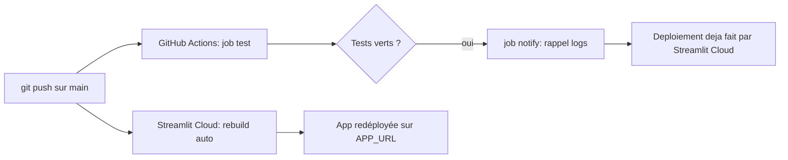

# Guide opérationnel — Déploiement 100 % gratuit sur Streamlit Community Cloud

> **Objectif** : héberger l'application Streamlit **AURA-Grid PoC** sur
> **Streamlit Community Cloud**, sans carte bancaire, sans facturation GCP, avec
> un redéploiement automatique à chaque `git push` sur `main`.
> **Public** : la personne qui exécute le déploiement (une seule fois) puis qui
> maintient l'application.
> **Compléments** : ce guide est **opérationnel**. Pour la justification des
> choix techniques (Cloud Run vs statique, `$PORT`, WebSockets, CORS/XSRF,
> sécurité), voir [`docs/DEPLOYMENT_ARCHITECTURE.md`](DEPLOYMENT_ARCHITECTURE.md:1).
> Pour la procédure Cloud Run complète (à n'utiliser qu'une fois la facturation
> GCP activée), voir [`docs/DEPLOYMENT_GUIDE.md`](DEPLOYMENT_GUIDE.md:1).

---

## Sommaire

1. [Pourquoi Streamlit Community Cloud](#1-pourquoi-streamlit-community-cloud)
2. [Prérequis](#2-prérequis)
3. [Étape 1 — Créer l'application](#3-étape-1--créer-lapplication)
4. [Étape 2 — Attendre le build et récupérer l'URL](#4-étape-2--attendre-le-build-et-récupérer-lurl)
5. [Étape 3 — Mettre à jour l'URL dans `app.py`](#5-étape-3--mettre-à-jour-lurl-dans-apppy)
6. [Étape 4 — Déploiement continu](#6-étape-4--déploiement-continu)
7. [Gestion des secrets (optionnel)](#7-gestion-des-secrets-optionnel)
8. [Ressources PDF](#8-ressources-pdf)
9. [Firebase Hosting en vitrine (optionnel)](#9-firebase-hosting-en-vitrine-optionnel)
10. [Dépannage](#10-dépannage)
11. [Limites du free tier](#11-limites-du-free-tier)
12. [Alternative Hugging Face Spaces](#12-alternative-hugging-face-spaces)
13. [Migration future vers Cloud Run](#13-migration-future-vers-cloud-run)
14. [Checklist finale](#14-checklist-finale)

---

## Conventions et placeholders

| Placeholder | Signification | Valeur du projet |
|---|---|---|
| `<GITHUB_OWNER>` | Compte GitHub propriétaire du dépôt | `filalisalah` |
| `<GITHUB_REPO>` | Nom du dépôt GitHub | `demo-phd-Ref-UOL08435` |
| `<BRANCH>` | Branche suivie par Streamlit Cloud | `main` |
| `<MAIN_FILE>` | Point d'entrée Streamlit | `app.py` |
| `<APP_NAME>` | Nom de l'application dans Streamlit Cloud | `aura-grid-poc` |
| `<APP_URL>` | URL publique générée | `https://aura-grid-poc.streamlit.app` |

> **Important** : `<APP_NAME>` détermine l'URL publique
> `https://<APP_NAME>.streamlit.app`. Le placeholder actuellement présent dans
> [`app.py`](../app.py:691) est `aura-grid-poc.streamlit.app`. Si vous choisissez
> un autre nom, mettez à jour ce lien (voir [Étape 3](#5-étape-3--mettre-à-jour-lurl-dans-apppy)).

---

## 1. Pourquoi Streamlit Community Cloud

| Critère | Streamlit Community Cloud | Firebase Hosting (Spark) | Cloud Run |
|---|---|---|---|
| Coût | **Gratuit à vie** | Gratuit (statique) | Facturation GCP **obligatoire** |
| Carte bancaire | **Non requise** | Non requise | Requise |
| Exécution Python/Streamlit | **Oui (natif)** | **Non** (statique uniquement) | Oui |
| Connexion | Compte GitHub | CLI Firebase | Docker + IAM |
| URL | `https://<APP_NAME>.streamlit.app` | `https://<PROJECT_ID>.web.app` | Domaine Cloud Run |
| Déploiement | Automatique sur `push` | `firebase deploy` | `gcloud run deploy` |

Points clés :

- **Gratuit à vie, sans carte bancaire** : aucune facturation n'est demandée
  pour un dépôt public.
- **Lié à GitHub** : Streamlit Cloud se connecte directement au dépôt
  `<GITHUB_OWNER>/<GITHUB_REPO>` et suit la branche `<BRANCH>`.
- **URL `*.streamlit.app`** : un sous-domaine public fourni automatiquement.
- **Support natif Streamlit** : la plateforme exécute `streamlit run <MAIN_FILE>`
  et installe `requirements.txt` ; aucun Dockerfile n'est nécessaire.

> ⚠️ **Firebase Hosting (plan Spark) ne peut PAS exécuter Streamlit.** Il ne
> sert que des fichiers statiques (HTML/CSS/JS). Une application Streamlit a
> besoin d'un processus Python côté serveur : Firebase Hosting ne peut donc pas
> l'héberger, même avec un `rewrite`.
>
> ⚠️ **Cloud Run exige la facturation.** Le projet GCP `e-learning-labo` n'a
> aucun compte de facturation attaché : Cloud Run, Artifact Registry et Cloud
> Build sont donc inutilisables en l'état (voir
> [`docs/DEPLOYMENT_GUIDE.md`](DEPLOYMENT_GUIDE.md:1)).

---

## 2. Prérequis

Avant de commencer, vérifiez que les éléments suivants sont en place :

- [ ] **Compte GitHub** ayant accès au dépôt
      `<GITHUB_OWNER>/<GITHUB_REPO>` (`filalisalah/demo-phd-Ref-UOL08435`).
- [ ] **Compte Streamlit Community Cloud** : création via « Sign in with GitHub »
      sur <https://share.streamlit.io> (aucune inscription séparée).
- [ ] **[`app.py`](../app.py:1) à la racine** du dépôt (point d'entrée).
- [ ] **[`requirements.txt`](../requirements.txt:1)** à la racine, listant les
      dépendances runtime (`streamlit`, `openai`).
- [ ] **[`runtime.txt`](../runtime.txt:1)** à la racine, contenant
      `python-3.11` (version Python utilisée par le build).
- [ ] **[`Ressources/`](../Ressources)** commité (les 3 PDF doivent être présents
      dans le dépôt, sinon les téléchargements échouent en ligne).
- [ ] **[`.streamlit/config.toml`](../.streamlit/config.toml:1)** commité
      (thème « Dark Modern » + `headless = true`).

Vérification rapide en local :

```bash
git status
git log -1 --oneline
# doit afficher le HEAD attendu, ex. 74743fd
```

---

## 3. Étape 1 — Créer l'application

1. Ouvrez <https://share.streamlit.io> et connectez-vous avec **GitHub**.
2. Cliquez sur **« Create app »** (bouton en haut à droite du dashboard).
3. Choisissez **« Deploy a public app from GitHub »**.
4. Renseignez les champs de l'écran de configuration :

   | Champ | Valeur à saisir |
   |---|---|
   | **Repository** | `<GITHUB_OWNER>/<GITHUB_REPO>` → `filalisalah/demo-phd-Ref-UOL08435` |
   | **Branch** | `<BRANCH>` → `main` |
   | **Main file path** | `<MAIN_FILE>` → `app.py` |
   | **App URL** (optionnel) | `<APP_NAME>` → `aura-grid-poc` (personnalisable) |
   | **Advanced settings** (optionnel) | Python version, secrets, packages — laisser par défaut |

5. Cliquez sur **« Deploy »**.

> **Remarque** : si le dépôt n'apparaît pas dans la liste, autorisez Streamlit
> Cloud à accéder à votre compte GitHub (bouton « Configure GitHub access » /
> « Grant access ») puis rechargez la page.

---

## 4. Étape 2 — Attendre le build et récupérer l'URL

Pendant le build, Streamlit Cloud :

1. clone le dépôt sur la branche `<BRANCH>` ;
2. lit [`runtime.txt`](../runtime.txt:1) et installe **Python 3.11** ;
3. installe les dépendances de [`requirements.txt`](../requirements.txt:1) ;
4. démarre l'application avec `streamlit run app.py`.

Le journal de build est visible en direct dans le dashboard (bouton
« Manage app » → logs). Une fois le statut passé à **« Running »**, l'URL
publique est :

```text
https://<APP_NAME>.streamlit.app
```

Exemple pour ce projet :

```text
https://aura-grid-poc.streamlit.app
```

> **Astuce** : l'URL exacte est affichée en haut du dashboard Streamlit Cloud et
> dans le menu « ⋮ » de l'application. Notez-la : elle sert à l'[Étape 3](#5-étape-3--mettre-à-jour-lurl-dans-apppy).

---

## 5. Étape 3 — Mettre à jour l'URL dans `app.py`

Le bouton **« 🎓 E-learning Portfolio »** du bandeau pointe vers une URL
codée en dur dans [`app.py`](../app.py:691) :

```python
("elearning", "🎓 E-learning Portfolio", "external", "https://aura-grid-poc.streamlit.app"),
```

- Si le nom d'application choisi à l'[Étape 1](#3-étape-1--créer-lapplication)
  est bien `aura-grid-poc`, **aucune modification n'est nécessaire**.
- Sinon, remplacez le placeholder par l'URL réelle `<APP_URL>`, puis commitez et
  poussez :

```bash
# 1. Éditer app.py : remplacer l'URL du tuple "elearning"
# 2. Vérifier le diff
git diff app.py

# 3. Committer et pousser sur main
git add app.py
git commit -m "chore: point E-learning Portfolio link to deployed Streamlit URL"
git push origin main
```

Le `push` déclenche automatiquement un redéploiement (voir
[Étape 4](#6-étape-4--déploiement-continu)).

---

## 6. Étape 4 — Déploiement continu

**Streamlit Community Cloud redéploie automatiquement l'application à chaque
`git push` sur la branche `<BRANCH>` (`main`).** Aucune commande de déploiement
n'est nécessaire.

Le workflow GitHub Actions [`.github/workflows/deploy.yml`](../.github/workflows/deploy.yml:1)
**ne déploie pas** : il ne fait que la **CI** (validation). Il contient deux
jobs :

| Job | Rôle | Secrets requis |
|---|---|---|
| `test` | installe [`requirements-dev.txt`](../requirements-dev.txt:1) et lance `python -m pytest -q` (29 tests) | aucun |
| `notify` | affiche un rappel dans les logs : Streamlit Cloud redéploie depuis `main` | aucun |

Déclencheurs du workflow : `push` sur `main`, `pull_request` vers `main`,
`workflow_dispatch` (manuel).



> **À retenir** : le workflow est **informatif** côté déploiement. La source de
> vérité du redéploiement est la connexion GitHub ↔ Streamlit Cloud. Un échec
> du job `test` n'empêche pas Streamlit Cloud de redéployer, mais il signale une
> régression à corriger.

---

## 7. Gestion des secrets (optionnel)

**Le mode par défaut ne requiert AUCUN secret.** L'application démarre en
**« Instant Offline Simulation »** : les opinions des agents sont pré-calculées
et reproductibles, sans appel réseau ni clé API.

Le mode **« Live DeepSeek LLM »** est optionnel. Dans ce mode, l'utilisateur
saisit lui-même sa **DeepSeek API key** dans la barre latérale (champ masqué
`type="password"`, voir [`app.py`](../app.py:855)). La clé n'est **jamais**
stockée côté serveur.

Si vous souhaitez **préconfigurer** une clé par défaut pour tous les visiteurs,
utilisez les **Secrets** de Streamlit Cloud (format TOML) :

1. Dashboard Streamlit Cloud → votre app → **« ⋮ »** → **« Settings »** →
   **« Secrets »**.
2. Collez un contenu TOML, par exemple :

   ```toml
   # .streamlit/secrets.toml (NE PAS committer ce fichier)
   DEEPSEEK_API_KEY = "<VOTRE_CLE_DEEPSEEK>"
   ```

3. Enregistrez : l'application redémarre et les secrets sont exposés via
   `st.secrets`.

> ⚠️ **Ne committez jamais** `.streamlit/secrets.toml` dans le dépôt. Les
> secrets Streamlit Cloud sont stockés côté plateforme, pas dans Git.
>
> ⚠️ **Exposer une clé partagée a un coût** : tout visiteur consommerait votre
> quota DeepSeek. Le mode offline par défaut reste la recommandation pour une
> démo publique.

---

## 8. Ressources PDF

Les 3 PDF de [`Ressources/`](../Ressources) sont :

- [`Master.pdf`](../Ressources/Master.pdf)
- [`Resume-EL FILALI.pdf`](../Ressources/Resume-EL%20FILALI.pdf)
- [`Cover letter AND Doctoral Research Proposal - EL FILALI.pdf`](../Ressources/Cover%20letter%20AND%20Doctoral%20Research%20Proposal%20-%20EL%20FILALI.pdf)

Ils sont servis via **`st.download_button`** (voir [`app.py`](../app.py:812)) :
le bouton **« ⬇️ Download »** diffuse directement les octets du PDF depuis le
dépôt, ce qui fonctionne **identiquement en local et sur Streamlit Community
Cloud**.

> **Pourquoi pas `localhost:8765` ?** L'ancien serveur HTTP statique interne
> produisait des URL `http://localhost:8765/...`. En ligne, `localhost` désigne
> la machine du **visiteur**, pas le serveur Streamlit : ces URL sont donc
> **inaccessibles**. Le serveur reste présent uniquement pour la compatibilité
> locale (lien « Open » dans un nouvel onglet), mais l'UI ne dépend plus de lui.

**Condition indispensable** : le dossier [`Ressources/`](../Ressources) doit être
**commité** dans le dépôt. Vérifiez-le :

```bash
git ls-files Ressources/
# doit lister les 3 fichiers .pdf
```

---

## 9. Firebase Hosting en vitrine (optionnel)

Firebase Hosting (plan Spark, gratuit) peut rester une **page d'accueil
statique** sur <https://e-learning-labo.web.app>, avec un bouton
**« Lancer la démo »** qui redirige vers l'URL Streamlit `<APP_URL>`.

1. Modifier [`public/index.html`](../public/index.html:1) : remplacer le contenu
   de la carte par un bouton/lien vers `<APP_URL>`. Exemple de bloc à insérer
   dans `<div class="card">` :

   ```html
   <h1>AURA-Grid PoC</h1>
   <p>Démonstrateur de recherche — application Streamlit hébergée gratuitement.</p>
   <p>
     <a class="cta" href="https://aura-grid-poc.streamlit.app">
       🚀 Lancer la démo
     </a>
   </p>
   ```

   (Ajoutez éventuellement un style `.cta` dans le `<style>` existant.)

2. Redéployer uniquement l'hébergement statique :

   ```bash
   firebase deploy --only hosting
   ```

   La configuration [`firebase.json`](../firebase.json:1) publie le dossier
   [`public/`](../public/index.html:1) ; elle ne contient **aucun** `rewrite`
   Cloud Run.

> Cette vitrine est **purement cosmétique** : elle n'exécute pas Streamlit. Elle
> sert de point d'entrée « propre » vers l'application réelle.

---

## 10. Dépannage

| Symptôme | Cause probable | Solution |
|---|---|---|
| **Build échoue** au démarrage | `requirements.txt` ou `runtime.txt` invalide / absent | Vérifier que les deux fichiers sont à la racine et bien formés (`python-3.11` sur une seule ligne) |
| **Module introuvable** (`ModuleNotFoundError`) | Dépendance manquante dans `requirements.txt` | Ajouter le paquet, committer, pousser |
| **App endormie** après inactivité | Mise en veille automatique du free tier | Ouvrir l'URL : le réveil est automatique (quelques secondes) |
| **PDF non téléchargeables** | `Ressources/` non commité ou fichier renommé | `git ls-files Ressources/` puis committer les PDF manquants |
| **Lien E-learning Portfolio cassé** | URL placeholder différente du nom réel | Mettre à jour [`app.py`](../app.py:691) (voir [Étape 3](#5-étape-3--mettre-à-jour-lurl-dans-apppy)) |
| **Mode Live en erreur** | Clé DeepSeek absente ou invalide | Saisir la clé dans la sidebar, ou repasser en mode offline |
| **Dépôt absent de la liste** | Accès GitHub non autorisé | « Configure GitHub access » sur share.streamlit.io |
| **App ne se met pas à jour** | Push sur une autre branche que `main` | Pousser sur `main` ou changer la branche dans les settings |

Consulter les logs : dashboard Streamlit Cloud → **« Manage app »** → onglet
logs (build + runtime).

---

## 11. Limites du free tier

- **RAM** : ~1 Go par application — suffisant pour cette démo, insuffisant pour
  des modèles lourds.
- **Mise en veille** : l'app s'endort après une période d'inactivité et se
  réveille à la première visite (délai de quelques secondes).
- **Ressources partagées** : CPU partagé, performances non garanties.
- **Pas de domaine personnalisé** : l'URL reste `https://<APP_NAME>.streamlit.app`
  (pas de CNAME vers un domaine propre).
- **Dépôt public** : le free tier suppose un dépôt public (les dépôts privés
  nécessitent un plan payant selon l'offre en vigueur).

---

## 12. Alternative Hugging Face Spaces

Si vous souhaitez un **contrôle plus fin** (Docker, variables d'environnement,
matériel configurable), **Hugging Face Spaces** est une alternative gratuite :

- Créez un Space de type **Docker** et pointez-le vers le
  [`Dockerfile`](../Dockerfile:1) existant (base `python:3.10-slim`, écoute sur
  `$PORT`).
- Avantage : réutilisation directe du [`Dockerfile`](../Dockerfile:1) déjà
  présent dans le dépôt.
- Inconvénient : configuration un peu plus manuelle que Streamlit Cloud.

> Pour un déploiement Streamlit « zéro configuration », Streamlit Community
> Cloud reste la voie recommandée.

---

## 13. Migration future vers Cloud Run

Si la **facturation GCP** est activée un jour sur le projet `e-learning-labo`,
la procédure complète (Artifact Registry, Workload Identity Federation,
`firebase.json` avec `rewrites`, job `deploy-cloud-run` du workflow) est décrite
dans [`docs/DEPLOYMENT_GUIDE.md`](DEPLOYMENT_GUIDE.md:1). Le job Cloud Run est
déjà présent, **commenté**, dans
[`.github/workflows/deploy.yml`](../.github/workflows/deploy.yml:31).

En attendant, **Streamlit Community Cloud est la solution de production
gratuite** de ce projet.

---

## 14. Checklist finale

- [ ] App créée sur <https://share.streamlit.io> (repo `filalisalah/demo-phd-Ref-UOL08435`, branche `main`, fichier `app.py`).
- [ ] Build terminé, statut **« Running »**, URL `https://<APP_NAME>.streamlit.app` notée.
- [ ] Lien « 🎓 E-learning Portfolio » de [`app.py`](../app.py:691) à jour (si nom ≠ `aura-grid-poc`).
- [ ] `Ressources/` commité → les 3 PDF se téléchargent depuis l'app en ligne.
- [ ] Mode offline vérifié (aucune clé requise) ; mode Live testé avec une clé saisie en sidebar.
- [ ] Workflow CI vert (jobs `test` + `notify`) sur `main`.
- [ ] (Optionnel) [`public/index.html`](../public/index.html:1) mis à jour avec un bouton « Lancer la démo » vers `<APP_URL>`, puis `firebase deploy --only hosting`.
